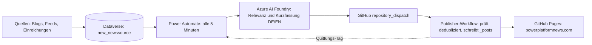

# Power Platform News

Kuratierte, quellenbasierte Kurzmeldungen zu **Power Apps, Power Automate und Copilot Studio** für [powerplatformnews.com](https://powerplatformnews.com). Power BI und Microsoft Fabric sind als Schalter vorbereitet und derzeit aus. „Copilot“ allgemein (Microsoft 365 Copilot, GitHub Copilot) gehört ausdrücklich nicht zum Scope.

> **Status: nicht live.** Die Seite ist absichtlich auf `noindex` (`launch: false` in `_config.yml`), kein Flow ist aktiv, IndexNow und Digest sind hinter der Repository-Variable `SITE_LIVE` gesperrt, die öffentliche Einreichung ist nicht freigegeben. Das Repository enthält keine Beiträge und keine Quellendaten, und im Tenant wurde nichts angelegt.
>
> - Was entschieden werden muss und wie die Lösung aufgebaut ist: [docs/2026-09-30_spezifikation_power-platform-news.md](docs/2026-09-30_spezifikation_power-platform-news.md)
> - Wie es Schritt für Schritt live geht (mit Freigabe-Toren): [docs/2026-09-30_go-live-runbook.md](docs/2026-09-30_go-live-runbook.md)

## So funktioniert es



Die Seite ist statisch (Jekyll mit dem Chirpy-Theme). Power Automate ist Aufnahme- und Verarbeitungs-Backend, GitHub ist die Veröffentlichungsquelle. Es werden nur kurze eigene Zusammenfassungen mit Quelle, Autor und direktem Link veröffentlicht, keine Volltexte, Bilder oder vollständigen Übersetzungen.

## Eine Datei für alles Seitenspezifische

Alles, was diese Seite von der Schwesterseite [Power Platform Governance](https://powerplatformgovernance.com) unterscheidet, steht in [`_data/profile.json`](_data/profile.json): Name, Domain, Themen-Scope, Tag-Liste, Dataverse-Namen, Flow-Kennungen, Farben, Karten- und Digest-Texte. Node, Ruby, Python und Jekyll lesen dieselbe Datei. Der Rest ist Engine und soll zwischen beiden Seiten identisch bleiben (Details im Abschnitt „Konvergenz-Vertrag“ der Spezifikation).

## Aufbau

| Pfad | Inhalt |
|---|---|
| `_data/profile.json` | Site-Profil (Identität, Scope, Taxonomie, Namen) |
| `_config.yml` | Jekyll-Konfiguration inkl. **Launch-Schalter** `launch` und Analytics-IDs (leer) |
| `_includes/`, `_layouts/`, `_plugins/`, `assets/` | Templates, Plugins, Formular-JS, Stil |
| `_tabs/` | About, Datenschutz, Einreichung, Quellen, Archiv, Tags |
| `tools/automation.mjs`, `tools/intake.mjs` | Generatoren der beiden Power-Automate-Flows |
| `tools/publish-curation.rb` | Publisher: validiert und schreibt DE/EN-Posts |
| `tools/bootstrap-solution.mjs` | Legt Lösung, eigene Tabelle, Connection References, Ansichten und Formular in Dataverse an (Trockenlauf als Standard, `--apply` schreibt, nur Ergänzungen) |
| `tools/deploy-*.ps1`, `tools/test-intake-live.ps1` | Bereitstellung der beiden Flows und Live-Test (brauchen `az login`) |
| `tools/seed-mvp-sources.mjs` | Legt Quellen in Dataverse an (Trockenlauf als Standard, `--apply` schreibt, Quellen standardmässig deaktiviert) |
| `tools/render_card.py`, `tools/send_digest.py` | Karten-Bilder, Digest-Mail |
| `.github/workflows/` | Build und Deploy, Publisher, IndexNow, Digest |
| `docs/` | Spezifikation und Go-Live-Runbook (nicht Teil der Website) |

## Lokal prüfen

```bash
export LC_ALL=C.UTF-8            # Ruby braucht UTF-8, sonst brechen Umlaute die Tests
bundle install
node --test tools/*.test.mjs
python3 -m py_compile tools/render_card.py tools/send_digest.py
bundle exec ruby tools/test-publish-curation.rb
JEKYLL_ENV=production bundle exec jekyll build
bundle exec ruby tools/check-site.rb _site
bundle exec htmlproofer _site --disable-external
```

`bash tools/run.sh` startet einen lokalen Server. Bei gebautem `launch: true` prüft `check-site.rb` mit `JEKYLL_CONFIG=_config.yml,<override>` den passenden Zustand.

## Geheimnisse und Variablen

Nie im Repository. Erst zum Go-Live setzen, siehe Runbook.

| Name | Art | Zweck |
|---|---|---|
| `SUBMISSION_ENDPOINT` | Actions-Secret | Callback-URL des Einreichungs-Webhooks, wird beim Build eingebunden |
| `SITE_LIVE` | Actions-Variable (`true`) | Schaltet IndexNow und Digest frei |
| `BREVO_API_KEY` | Actions-Secret | Digest-Versand, nur falls der Digest aktiviert wird |
