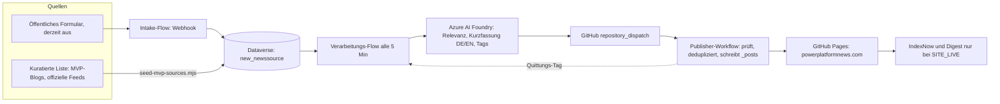

# Spezifikation: Power Platform News

Stand: 30.09.2026 · Status: **Entwurf zur Freigabe, nichts ist live** · Branch `ccr-453447c5-qyg2zo` (nicht gemerged)
Bezug: Governance-Repo `powerplatformgovernance` @ `4f34575`. Verweise der Form `gov:datei:zeile` meinen dieses Repo.
Das Go-Live selbst steht im [Runbook](2026-09-30_go-live-runbook.md).

## 1. Kurzfassung und Empfehlung

**Ist die Idee Unsinn? Nein.** Der Bestand ist im Kern eine themenneutrale Kuratierungs-Engine mit einer dünnen Governance-Schicht. Der Wechsel auf Power Platform News ist überwiegend Konfiguration: Die erzeugten Flow-Definitionen (Verarbeitung 1.217 Zeilen, Einreichung 291 Zeilen JSON) unterscheiden sich vom Governance-Original nur in Tabellen- und Schlüsselnamen, GitHub-Ziel, User-Agent und dem Scope der beiden Prompts. Die Aktionsstruktur ist identisch.

**Aber nicht als 1:1-Einschalten.** Fünf Bedingungen müssen erfüllt sein, bevor die Seite Inhalte öffentlich ausspielt:

1. **Scope-Schärfe.** „Copilot Studio, nicht Copilot“ ist nur so gut wie der Prompt. Er ist geschrieben, aber noch nicht an echten Beispielen geprüft (WP-04).
2. **Vertrauensmodell der Quellen.** Im Bestand wird jede öffentlich eingereichte Feed-URL ohne Prüfung freigegeben und dauerhaft abgefragt (Befund F5). Für eine öffentlichere Seite ist das zu offen.
3. **Kapazität.** Ein sequenzieller Fünf-Minuten-Flow verbraucht schon mit 15 Quellen geschätzt rund 90.000 Aktionen pro Tag, ab ca. 50 Quellen rund 300.000 (Abschnitt 7). Lizenz und Laufzeit müssen vor dem Ausbau gemessen werden.
4. **Rechts- und Transparenzpunkte** vor dem Launch: KI-Kennzeichnung, Leistungsschutzrecht, Microsoft-Marke, Impressum, Datenschutz (Abschnitt 6, E11).
5. **Zwei Fehler in der Aufhol-Logik** beheben, die bei einer aktiveren Seite eher zuschlagen (F1, F2).

**Empfehlung:** **GO für einen Stufenplan** (Seite unsichtbar → Pilot mit 10–15 Quellen → stufenweiser Ausbau → Launch). **NO-GO** für „alle 284 vorbereiteten Quellen und öffentliche Einreichung am ersten Tag“.

**Was bereits im Branch liegt:** ein vollständiger Funktionsklon, profilgesteuert und abgesichert, **ohne dass etwas live geht** (Launch-Schalter aus, alle Seiten `noindex`, `robots.txt` sperrt alles, keine Flows, IndexNow und Digest gesperrt, öffentliche Einreichung nicht freigegeben). **Im Tenant wurde nichts angelegt oder verändert.**

**Was von Marcel gebraucht wird:** 11 Entscheidungen (Abschnitt 8, davon 6 vor dem Pilot) und gemeinsame, interaktive Sitzungen für alles, was nur im Tenant geht (Dataverse-Bereitstellung, GitHub-Zustimmung, DNS).

## 2. Was geklont wurde und was nicht

### 2.1 Vorgehen

- **Commit 1** ist ein unveränderter Snapshot von Engine und Site-Skelett (71 Dateien). **Commit 2** enthält alle Änderungen für News. So zeigt `git diff` exakt, was sich geändert hat.
- Von den 71 Dateien blieben **38 unverändert**, 33 wurden angepasst, 1 verschoben. Dazu kommen 11 neue Dateien (u. a. Profil, zwei Test-Dateien, diese Doku).
- Die generierten Flow-Definitionen wurden gegen das Governance-Original verglichen: Es weichen nur Identitätsangaben ab (siehe oben).

### 2.2 Übernommen (Funktionsumfang)

Statische Chirpy-Seite mit DE/EN-Beiträgen und hreflang · Einreichungsformular und Webhook-Flow · Verarbeitungs-Flow (alle 5 Minuten, sequenziell, vier Quellarten: Artikel, RSS, YouTube, Podcast) · KI-Gate für Einreichungen · KI-Extraktion (Relevanz, Kurzfassung DE/EN, Tags, Kartentexte) · Publisher-Workflow mit Validierung, Deduplizierung und Quittungs-Tag · Karten-Bilder · Quellen-, Tag- und Archivseiten · SEO/GEO (JSON-LD, Canonical, hreflang, Sitemap, `llms.txt`) · IndexNow · Consent-Banner mit Google Analytics und Clarity · PWA · Brevo-Digest · MVP-Quellenlisten und Seed-Skript · Deploy-Skripte · Tests und CI.

### 2.3 Bewusst nicht übernommen

| Was | Warum |
|---|---|
| 76 Beitragspaare und 33 Kartenbilder | Identische Texte auf zwei Domains sind ein SEO-Risiko, und die Inhalte sind Governance-spezifisch (E2) |
| Seite „Admin Flows“ (10 Flows) | Governance-Inhalt, verweist auf Governance-Beiträge |
| `CNAME`, IndexNow-Schlüssel, GA- und Clarity-IDs der Governance-Seite | Identität der anderen Domain. Für News neu erzeugt bzw. leer |
| `README_CUSTOM.md` und vier Architektur-Dokumente | Teils veraltet (Anhang A, F3). Ersetzt durch diese Spezifikation |
| `digest-sent.json` | Zustand des anderen Digests. News startet leer |

### 2.4 Aus dieser Umgebung nicht klonbar (Tenant-Seite)

Es gab weder `az`- noch `pac`-Zugriff auf den Tenant, und die Sandbox blockiert externe Hosts. Was **im Code** liegt und damit geklont ist: Tabellen-Definition, beide Flow-Definitionen, Deploy-Skripte. Was **nicht** im Repo liegt und deshalb im Tenant neu entsteht: Lösung, Formular, vier Ansichten, fünf Connection References, der Custom Connector `AzureAIFoundry-Privat` (wird wiederverwendet, nicht neu gebaut) und die Laufhistorie (F7). Siehe WP-01 und WP-18.

## 3. Zielbild und Scope

### 3.1 Positionierung

Power Platform News sammelt, was in **Power Apps, Power Automate und Copilot Studio** neu ist, als kurze, quellenbasierte Zusammenfassung mit Hinweis „Was das bedeutet“ und direktem Link zum Original. Die Schwesterseite Power Platform Governance bleibt für Steuerung, Sicherheit und Betrieb zuständig. Beide verlinken einander.

**Nicht-Ziele:** keine Volltexte, keine vollständigen Übersetzungen, keine fremden Bilder, keine Kommentare, keine Inhalte hinter Login oder Paywall.

### 3.2 Scope

| Bereich | Status | Hinweis |
|---|---|---|
| Power Apps (Canvas, Model-driven, Code Apps, Maker-Erlebnis) | **im Scope** | Produkt-Tag `power-apps` |
| Power Automate (Cloud- und Desktop-Flows, Agent-Flows, Connectors) | **im Scope** | Produkt-Tag `power-automate` |
| Copilot Studio (Agenten bauen, erweitern, verwalten, Lizenz/Credits) | **im Scope** | Produkt-Tag `copilot-studio` |
| Dataverse, Power Pages | begleitend | Nur im Zusammenhang mit den drei Produkten. Tags `dataverse`, `power-pages` |
| Plattformweite Änderungen (Admin, Lizenz, ALM, Sicherheit, Roadmap) | begleitend | Soweit sie die drei Produkte direkt betreffen |
| Microsoft 365 Copilot, GitHub Copilot, Security Copilot, Dynamics-365-Copilot, Consumer-Copilot | **außerhalb** | Nur im Scope, wenn es um das **Bauen von Agenten mit Copilot Studio** geht |
| Power BI, Microsoft Fabric | **Schalter, aus** | In `_data/profile.json` unter `tags.optional`. Aus, weil die Quellenbasis fehlt: von 109 MVP-Blogs deckt keiner Power BI ab und einer Fabric |
| Allgemeine KI-Nachrichten, Werbung, Stellenanzeigen, Event-Anmeldeseiten | außerhalb | |

### 3.3 Was als „News“ zählt

Etwas Neues oder Geändertes: Ankündigung, Preview, allgemeine Verfügbarkeit, Einstellung (Deprecation), Preis- oder Lizenzänderung, Roadmap, Sicherheitshinweis, bemerkenswerter Community-Beitrag zu einer neuen Fähigkeit. Weiche Frischeregel im Prompt: älter als 12 Monate oder lange vergangene Ereignisse als „bevorstehend“ → nicht veröffentlichen. Die Regel ist nur ein Prompt-Hinweis, keine harte Prüfung (WP-04 entscheidet, ob eine harte Prüfung im Flow nötig ist).

### 3.4 Taxonomie (Tags)

- **Produkte:** `power-apps`, `power-automate`, `copilot-studio`, `dataverse`, `power-pages`
- **Themen:** `ai-agents`, `announcement`, `how-to`, `licensing`, `deprecation`, `security`, `governance`, `alm`, `community`
- **Phase 2 (aus):** `power-bi`, `fabric`

Die Liste steht nur im Profil. Prompt und Publisher lesen beide daraus und können nicht auseinanderlaufen (Test: *the extraction prompt offers exactly the active tags*).

### 3.5 Inhaltsregeln

Übernommen aus den Governance-Kurationsregeln: Quelle, Autor und Originaltitel vor der Zusammenfassung; Hauptlink direkt zum Original; Kurzfassung statt Ersatz (Ziel 35–65 Wörter, im Bestand Ø 52, Spanne 42–78); Originaldatum getrennt vom Beitragsdatum; Einreicher-Namen nur mit ausdrücklicher Zustimmung; Offenlegung gemeinsamer Herausgeberschaft (PowerPlatformTip).
Neu für News: Status-Angabe (GA, Preview, Rolling out, Retiring) auf der Karte, Überschrift „What it means / Was das bedeutet“, **sichtbarer KI-Hinweis je Beitrag** (E5) und der Hinweis „unabhängig, nicht mit Microsoft verbunden“.

## 4. Architektur

### 4.1 Ende-zu-Ende

### 4.2 Entscheidung: eigene Lösung statt gemeinsamer Flow

Empfohlen: eigene Lösung `PowerPlatformNews` in **derselben Umgebung** wie Governance, mit eigener Tabelle `new_newssource`, eigenen Connection References (`new_news_*`) und zwei eigenen Flows. Wiederverwendet werden Umgebung, Custom Connector `AzureAIFoundry-Privat` und die Foundry-Bereitstellungen `model-router` und `whisper`.

| Kriterium | Eigene Lösung (empfohlen) | Gemeinsame Tabelle und Flow |
|---|---|---|
| Isolation bei Fehlern und Missbrauch | hoch: ein Flow kann ausgeschaltet werden, ohne die andere Seite zu berühren | niedrig: Fehler trifft beide Seiten |
| Durchsatz | zwei unabhängige Warteschlangen | eine Warteschlange, halbiert den Durchsatz je Seite |
| Doppelte Abfragen derselben Feeds | ja (Nachteil) | nein |
| Aufwand der Umstellung | gering, weil Generator und Deploy parametrisiert sind | hoch: Mandantenspalte, zwei Quittungen je Quelle, Dispatch je Seite |

Die gemeinsame Variante lohnt sich erst, wenn Doppelabfragen zum Problem werden (Abschnitt 7). Dann ist die Zusammenlegung ein eigenes Projekt.

### 4.3 Das Profil als einzige Quelle der Wahrheit

`_data/profile.json` enthält Namen, Domain, Scope-Texte, Tags, Dataverse- und Flow-Namen, Flow-Kennungen, Farben, Karten- und Digest-Texte. Es wird gelesen von:

| Verbraucher | Nutzt |
|---|---|
| `tools/automation.mjs`, `intake.mjs`, `seed-mvp-sources.mjs` (Node) | Konfiguration, Prompts, Tabellendefinition |
| `tools/publish-curation.rb` (Ruby) | Tag-Liste, Autor-ID, Überschriften, Karten-Alt-Text, Offenlegung |
| `tools/render_card.py`, `send_digest.py` (Python) | Kicker, Hashtag, Domain, Digest-Einstellungen |
| Jekyll-Templates (`site.data.profile`) | Palette, Sameas-Liste, KI-Hinweis |
| PowerShell-Skripte | über die von Node ausgegebene Konfiguration |

### 4.4 Launch-Schalter und Tore

| Mechanismus | Wirkung | Standard jetzt |
|---|---|---|
| `launch` in `_config.yml` | `false`: `noindex` auf jeder Seite, `robots.txt` sperrt alles, keine Sitemap-Angabe | `false` |
| Repository-Variable `SITE_LIVE` | Gibt IndexNow und Digest frei | nicht gesetzt |
| `direct_webhook` in `_data/submission.yml` | `false`: Build lehnt die signierte Webhook-URL ab, Formular bleibt deaktiviert | `false` |
| Secret `SUBMISSION_ENDPOINT` | Ohne Secret ist das Formular deaktiviert | nicht gesetzt |
| `digest.enabled` im Profil | `false`: Digest sendet nichts | `false` |
| Flows | werden ausgeschaltet bereitgestellt | nicht bereitgestellt |
| Seed-Skript | legt Quellen freigegeben, aber **deaktiviert** an | |

`check-site.rb` erzwingt, dass gerenderte Seiten und `robots.txt` zum Schalter passen. Ein gestarteter Build besteht die Prüfung für „nicht gestartet“ nicht, und umgekehrt (Negativkontrolle im Test).

### 4.5 Datenmodell und Zustände

Tabelle `new_newssource` mit denselben Feldern wie im Bestand: Name, URL, Quelltyp (Artikel, RSS, YouTube, Podcast), Freigabe, Verarbeitung aktiviert, Verarbeitungsstatus, Einreicher-Felder mit Einwilligung, Zeitstempel, Wasserzeichen, gesehene Feed-IDs, Fehlerzähler, letzter Status. Die Zahlenwerte der Auswahlfelder sind im Code fest (z. B. Artikel `100000000`, RSS `100000001`).
Ablauf: `Needs review → Ready → Awaiting GitHub result → Published` (Artikel) bzw. zurück auf `Ready` (RSS); Fehler → `Error`, nach drei Fehlern `Needs review`; ohne GitHub-Quittung nach 24 Stunden → `Needs review`.

### 4.6 Sicherheitsmerkmale (übernommen)

Nur HTTPS, Port 443, keine Zugangsdaten in URLs, keine IP-Ziele · fremde Inhalte sind „untrusted data“ in den Prompts · Modellausgabe wird im Publisher erneut streng validiert (Länge, Tag-Liste, URL, Datum, Escaping von HTML und Liquid) · URL wird vom Flow gesetzt, nicht vom Modell · Publisher akzeptiert nur den konfigurierten GitHub-Akteur · Honeypot-Feld und Einwilligung nur bei `yes` · Erfolgsquittung als Git-Tag `curation-results/<id>`.

## 5. Funktionsmatrix

| Funktion | Governance (Bestand) | News-Klon | Anmerkung |
|---|---|---|---|
| Statische Seite, PWA, DE/EN-Beiträge mit hreflang | ja | übernommen | Farben aus Profil. Keine DE-Startseite (E9) |
| Einreichungsformular | ja | übernommen, **deaktiviert** | `direct_webhook: false` (E4) |
| Intake-Webhook-Flow | ja | übernommen, nicht bereitgestellt | Name aus Profil |
| Verarbeitungs-Flow, vier Quellarten | ja | übernommen, **logikgleich** | Deploy legt den Flow bei Erstinstallation an |
| KI-Gate für Einreichungen | ja, autonom | übernommen, Scope News plus Frische | Vertrauensmodell E3 |
| KI-Extraktion | ja | übernommen, Prompt für News | Copilot-Studio-Abgrenzung |
| Publisher-Workflow | ja | übernommen | Tags, Autor, Überschrift aus Profil |
| Karten-Bilder | ja | übernommen | Kicker, Hashtag, Domain aus Profil, neutraler Status-Punkt statt Häkchen |
| Quellen-, Tag-, Archivseite | ja | übernommen | |
| SEO/GEO, Sitemap, `llms.txt` | ja | übernommen, domain-neutral | Bild-URLs im JSON-LD jetzt absolut |
| `robots.txt` | ja | **neu**: per Launch-Schalter | Behebt F9 |
| IndexNow | ja | übernommen, hinter `SITE_LIVE` | Domain und Schlüssel aus Profil |
| Consent-Banner, GA, Clarity | ja | übernommen, **nur mit IDs** | Banner nennt aktive Dienste, DE/EN (behebt F4) |
| Datenschutzseite | nur GA | **neu geschrieben**, bedingt | Rechtsprüfung E11 |
| Digest (Brevo) | ja | übernommen, **aus** | E8 |
| Seed-Skript und MVP-Listen | ja, aktiv | übernommen, **deaktiviert**, `--limit`, Scope-Filter, YouTube nur per Option | doppelte Kanäle werden entfernt |
| Deploy-Skripte | ja | übernommen, parametrisiert | nur Syntax geprüft, nicht ausgeführt |
| Tests und CI | ja | übernommen, plus 19 neue Tests | 36 Node-Tests, Publisher- und Seitenprüfungen |
| Admin-Flows-Seite, Altbeiträge | ja | **nicht übernommen** | siehe 2.3 |
| Profil, Launch-Schalter, KI-Hinweis je Beitrag | nein | **neu** | |

## 6. Ehrliche Bewertung: Risiken und Bedingungen

| # | Risiko | Warum es zählt | Gegenmaßnahme |
|---|---|---|---|
| R1 | Scope-Drift: allgemeine Copilot-Nachrichten rutschen durch | „Copilot“ ist der häufigste Begriff im Umfeld und leicht zu verwechseln | Expliziter Ausschluss in beiden Prompts, Test auf Präsenz. **WP-04**: Stichprobe mit echten Grenzfällen |
| R2 | Öffentliche Feeds werden ohne Prüfung freigegeben | Kapazität, Backlink-Missbrauch, Angriffsfläche für Prompt-Injection | Öffentliche Einreichung aus (E4). **WP-06**: Feeds nur nach manueller Freigabe |
| R3 | Kapazität und Lizenz des Polling-Flows | Abschnitt 7 | **WP-05**, Fallback-Architektur (E10) |
| R4 | SEO: „Scaled Content“ und fehlender Mehrwert | Automatisch erzeugte Zusammenfassungen fremder Inhalte in Masse sind ein bekanntes Qualitätsrisiko bei Suchmaschinen | Mehrwert durch „What it means“, Produkt-Tags und Statusangabe. Keine Kopie der Governance-Texte. Soft-Launch hinter `noindex`. Qualitätsstichproben im Pilot |
| R5 | Urheber- und Leistungsschutzrecht | Bei einer *News*-Seite nah an Presse-Inhalten. Was in Deutschland als „sehr kurzer Auszug“ gilt, ist nicht abschließend geklärt. Die Zusammenfassungen haben im Schnitt 52 Wörter | Eigene Worte, keine Zitate, keine Bilder. **WP-08** Blocklist und Takedown. **E11** rechtliche Prüfung |
| R6 | Transparenz bei KI-Texten | Die EU-KI-Verordnung kennt Kennzeichnungspflichten für KI-erzeugte Texte, die die Öffentlichkeit informieren sollen. Anwendbarkeit, Ausnahmen und Fristen sind zu prüfen | Sichtbarer KI-Hinweis je Beitrag und auf der About-Seite (im Klon umgesetzt). **E11** |
| R7 | Marke „Power Platform“ und Nähe zu Microsoft | Domain und Name verwenden Microsoft-Marken | Klarer Unabhängigkeits-Hinweis (im Klon umgesetzt). **E11**: Microsoft-Markenrichtlinien prüfen |
| R8 | Datenschutz und Anbieterkennzeichnung | Kein Impressum, Datenschutz nur Englisch, Verarbeiter (Microsoft, GitHub, ggf. Brevo) teils nicht genannt | **WP-09** |
| R9 | Missbrauch des öffentlichen Formulars | Kein Rate-Limit, kein CAPTCHA (bewusst akzeptiert im Bestand) | Formular aus. **WP-13** Schutz vor Freigabe |
| R10 | Zwei Forks driften auseinander | Fehlerkorrekturen müssen doppelt gemacht werden | Konvergenz-Vertrag (Anhang B), **WP-17** |
| R11 | YouTube und Podcast unbelegt | 0 von 152 Posts, undokumentierter Endpunkt, fehlerhafte Kanalzuordnung (F6) | Nur per Option, erst nach eigener Prüfung |
| R12 | Breite GitHub-Berechtigung | Die Power-Platform-Verbindung arbeitet mit weitreichenden OAuth-Rechten am Konto (F12) | Feingranulare Alternative prüfen, Verbindung nur für diesen Zweck |
| R13 | Betrieb hängt an wenigen Konten | Niemand bemerkt Ausfälle | **WP-12**: Alarme für Flow, Publisher und Budget |

## 7. Kapazität und Kosten

### 7.1 Bekannte Größen

- **Quellenbasis:** 109 MVP-Blogs (106 verschiedene Feed-Hosts), davon **107** mit Bezug zu Power Apps, Power Automate oder Copilot Studio. 175 YouTube-Kanäle (171 verschiedene, vier Kanäle sind je zwei Personen zugeordnet), standardmäßig nicht gesät. Offizielle Microsoft-Feeds sind **nicht** in den Listen (WP-03).
- **Bestandsleistung Governance:** 61 kuratierte Beitragspaare in 8 Tagen aus 14 Quellen-Sites, davon 44 an zwei Backfill-Tagen. Danach 1–2 pro Tag. Hinweis: Wie viele Quellen im Governance-Flow aktuell aktiv sind, ist aus dem Repo nicht ablesbar.
- **Aktionen pro ruhender RSS-Quelle:** 21 (aus der Flow-Definition gezählt, alle vorhanden) plus 3 pro Lauf.

### 7.2 Modell (Annahme: 6 s je ruhender Quelle)

Die 6 Sekunden sind eine **Annahme**, die Größenordnung (Faktor 2–3) zählt, nicht die Zahl.

| Aktive Quellen | Aktionen je Lauf | Laufdauer | Läufe/Tag | Aktionen/Tag (≈) |
|---|---|---|---|---|
| 15 | 318 | 1,5 min | 288 | 92.000 |
| 50 | 1.053 | 5 min | 288 | 303.000 |
| 107 | 2.250 | 10,7 min | 134 | 302.000 |
| 278 (inkl. YouTube) | 5.841 | 27,8 min | 51 | 298.000 |

Lesart: Ab etwa 50 Quellen ist der Flow **dauerbeschäftigt**, und der Tagesverbrauch hängt nur noch von der Dauer einer Aktion ab (≈ 86.400 s ÷ Sekunden je Aktion). Die „5 Minuten“ sind dann nur noch Wunschtakt, tatsächlich wird jede Quelle erst nach einer Laufdauer wieder abgefragt. Die Lizenzgrenzen für Anfragen pro 24 Stunden liegen je nach Lizenz zwischen einigen Zehntausend und 250.000 (aktuelle Werte: Microsoft-Dokumentation „Requests limits and allocations“). Überschreitung führt in der Regel zur Drosselung, nicht zum Abschalten, was die Laufzeit weiter verlängert.

### 7.3 Stellhebel

1. **Poll-Intervall je Quelle:** nur Quellen abfragen, deren `new_lastchecked` älter als z. B. 30 Minuten ist (Filter in `List_sources`). Reduziert die Last grob um den Faktor 6 bei 30 Minuten.
2. **Staffelung:** selten postende MVP-Blogs seltener, Microsoft-Kanäle häufiger.
3. **Klein anfangen:** Pilot mit 10–15 Quellen.
4. **Fallback:** Polling in einen GitHub-Actions-Job verlegen (Node-Skript, kostenlos, versioniert), Power Automate nur noch für Einreichung und Dispatch. Auslöser: Laufdauer > 15 Minuten im Regelbetrieb oder dauerhafte Drosselung.

### 7.4 Kosten, die zu klären sind

- **Lizenz:** Beide Flows nutzen HTTP und einen Custom Connector (Premium). Deckt die vorhandene Lizenz zwei weitere Cloud-Flows ab, und wie viele Anfragen sind darin enthalten?
- **KI:** Pro neuem Kandidaten ein Foundry-Aufruf mit bis zu 30.000 Zeichen Seitentext, pro Einreichung zusätzlich das Gate. Den Preis der `model-router`-Bereitstellung kenne ich nicht. Im Pilot messen, Budget-Alarm setzen (WP-12).

## 8. Offene Entscheidungen

„Wann“: **P** = vor dem Pilot, **L** = vor dem Launch, **S** = später.

| # | Entscheidung | Empfehlung | Wann |
|---|---|---|---|
| E1 | Scope: Power Pages als Begleit-Tag, Power BI und Fabric aus? | Ja und ja. Power BI/Fabric erst mit eigener Quellenbasis (WP-15) | P |
| E2 | Governance-Altbestand kopieren? | **Nein.** Start leer, optional Backfill über die Pipeline mit Startzeitpunkt | P |
| E3 | Vertrauensmodell: A = kuratierte Liste (vorfreigegeben), B = öffentliche Einzelartikel (KI-Gate), C = öffentliche Feeds | C nur mit **manueller Freigabe** (WP-06). B darf beim KI-Gate bleiben | P |
| E4 | Öffentliche Einreichung: wann? | Erst nach WP-06 und WP-13 (Rate-Limit oder CAPTCHA). Bis dahin aus | P |
| E5 | Sichtbare KI-Kennzeichnung je Beitrag | **Ja** (im Klon umgesetzt, Text im Profil änderbar) | P |
| E6 | Marke und Kanäle: Farben, Logo, Favicon, LinkedIn-Seite? | Placeholder-Palette und -Social-Bild sind drin. Final durch Marcel | L |
| E7 | Analytics: eigene GA4-Property und Clarity-Projekt? | Ja, **nicht** die Governance-IDs mitnutzen | L |
| E8 | Digest zum Launch? | Nein. Erst mit Anmeldeformular, Double-Opt-in, Absender und Datenschutztext | S |
| E9 | Sprachen: DE/EN wie Governance, DE-Startseite und DE-Listen? | DE/EN ja. DE-Listen in Phase 2 (WP-16) | S |
| E10 | Kapazitätsgrenze und Fallback | Siehe 7.3: Messen im Pilot, Schwelle 15 Minuten Laufdauer | P |
| E11 | Rechtliche Prüfung vor Launch | Ja, extern: Leistungsschutzrecht, Microsoft-Marke, Impressum, KI-Kennzeichnung, Datenschutz inkl. Auftragsverarbeitung | L |

## 9. Arbeitspakete

Aufwand ist eine grobe Schätzung. „M“ = Marcel erforderlich (Tenant, Konten, Entscheidungen).

| WP | Inhalt | Aufwand | Akzeptanzkriterium | Tor |
|---|---|---|---|---|
| 00 | Klon, Profil, Launch-Schalter, Tests, Doku (**erledigt** in diesem Branch) | – | 36 Node-Tests, Publisher-Tests, Build in beiden Launch-Zuständen, `check-site`, `htmlproofer` grün | – |
| 01 | **Dataverse-Bereitstellung (M):** Lösung, Tabelle per Web API aus `tableDefinition` (feste Auswahlwerte!), Formular, 4 Ansichten, 5 Connection References, Verbindungen binden, beide Flows deployen (aus) | 4–8 h | `deploy-automation.ps1` und `deploy-intake.ps1` melden `DefinitionVerified = True`, beide Flows existieren und sind aus | 2 |
| 02 | **Seite und Domain (M):** Pages-Quelle „GitHub Actions“, Custom Domain, DNS, HTTPS, Domain-Verifizierung, Merge Branch → `main` | 1–2 h plus DNS-Wartezeit | Build grün, Seite erreichbar, `robots.txt` = `Disallow: /`, `noindex` auf jeder Seite | 1 |
| 03 | **Quellen:** offizielle Microsoft-Feeds recherchieren und **einzeln verifizieren**, in `tools/extra-sources.json`. Pilot-Set 10–15 festlegen | 2–4 h | Jede URL liefert HTTP 200 und gültiges XML | 3 |
| 04 | **Prompt-Evaluation:** 40–60 echte Items (Treffer, Fehltreffer, Copilot-Grenzfälle, Preview-als-GA) durch die Extraktion schicken und bewerten | 0,5–1 Tag | Präzision ≥ 90 %, **0** Treffer zu M365-Copilot oder GitHub Copilot in der Stichprobe, keine Preview als GA dargestellt | 3 |
| 05 | **Kapazitätsmessung** im Pilot: Laufdauer und Aktionen aus der Laufhistorie, Hochrechnung | 1 h/Woche | Zahl je Lauf und je Tag dokumentiert, E10 entschieden | 4 |
| 06 | **Vertrauensmodell härten:** `Is_feed` darf öffentliche Feeds nicht mehr automatisch freigeben (Freigabe bleibt offen). `rel="nofollow"` für nicht kuratierte Quellen prüfen | 0,5–1 Tag | Testfall: eingereichter Feed bleibt `Awaiting approval` | 4 |
| 07 | **Aufhol-Logik korrigieren (F1, F2)** in beiden Seiten | 2–4 h | Test: Feed mit 45 ungesehenen Einträgen verarbeitet alle in drei Läufen, gesehene IDs bleiben begrenzt | 4 |
| 08 | **Blocklist und Takedown:** Publisher und Intake prüfen gegen eine Sperrliste (URL oder Host) | 2–4 h | Gesperrte URL wird nicht veröffentlicht, auch nicht nach erneuter Einreichung | 5 |
| 09 | **Recht und Datenschutz:** Impressum, deutsche Datenschutzerklärung, Verarbeiter, Ergebnis von E11 einarbeiten (M, extern) | extern | Freigabe durch Marcel | 5 |
| 10 | **Marken-Assets:** Logo, Favicon, finales Social-Bild, Palette (M) | extern | Ersetzt die Platzhalter | 5 |
| 11 | **Analytics:** IDs eintragen, Banner-Test in DE und EN | 1 h | Banner nennt nur aktive Dienste, nichts lädt vor Zustimmung | 5 |
| 12 | **Überwachung:** Alarm bei Flow-Fehlern, Publisher-Fehlern (GitHub-Benachrichtigung) und Foundry-Budget, Uptime-Check | 2–4 h | Testalarm kommt an | 5 |
| 13 | **Schutz der Einreichung (optional):** Proxy mit Rate-Limit und Bot-Schutz vor dem Webhook | 1–2 Tage | Missbrauchstest gedrosselt | nach E4 |
| 14 | **Digest (optional):** Anmeldung, Double-Opt-in, Liste, Absender | 0,5–1 Tag | siehe E8 | S |
| 15 | **Power BI und Fabric:** Quellenbasis, Prompt, Tags, Schalter im Profil | 2–3 Tage | Stichprobe wie WP-04 | S |
| 16 | **DE-Startseite, DE-Archiv, DE-Tags**, Seitenleisten nach Sprache filtern (F15) | 1–2 Tage | DE-Nutzer erreichen Inhalte ohne Umweg über EN, keine gemischten Sprachen in Seitenleisten | S |
| 17 | **Gemeinsame Engine:** Profil-Anpassungen nach Governance zurückportieren, Fixes in einer Quelle pflegen | 1–2 Tage | Beide Repos haben identischen Engine-Code | S |
| 18 | **Lösung ins Repo exportieren** (`pac solution export` und `unpack`) als Wiederherstellungs- und Klonbasis (M) | 1–2 h | Entpackte Lösung im Repo | S |

## 10. Go-Live-Stufen und Kriterien

Der Ablauf mit Befehlen steht im [Runbook](2026-09-30_go-live-runbook.md). Kurzform:

| Tor | Zustand | Bedingung zum Weitergehen |
|---|---|---|
| 0 | Entscheidungen | E1–E5 und E10 bestätigt |
| 1 | Seite steht, unsichtbar | WP-02 erledigt, `noindex` und `Disallow` per `curl` belegt |
| 2 | Flows bereit, aus | WP-01 erledigt, `DefinitionVerified = True` |
| 3 | Pilot (10–15 Quellen, 7–14 Tage, noch `noindex`) | WP-03 und WP-04 erledigt. Tägliche Sichtkontrolle |
| 4 | Ausbau (+25 Quellen pro Woche) | WP-05, WP-06, WP-07 erledigt. Laufdauer im Rahmen |
| 5 | Launch | WP-08 bis WP-12 erledigt. `launch: true` und `SITE_LIVE=true` gleichzeitig |

**Messbare Kriterien für Tor 3 → 4:** Präzision ≥ 90 % in einer Stichprobe von 50 Beiträgen · 0 falsche Copilot-Zuordnungen · keine Preview als GA · mittlere Laufdauer ≤ 4 Minuten bei ≤ 15 Quellen · keine ungeklärten Flow-Fehler · Foundry-Kosten je veröffentlichtem Beitrag dokumentiert und im Budget.
**Notbremse:** Flow ausschalten, `launch: false` setzen und `SITE_LIVE` entfernen, fehlerhafte Beiträge per Commit löschen.

## 11. Nicht geprüft und Annahmen

- **Kein Tenant-Zugriff.** Nicht gesehen: aktive Flows, Laufhistorie, Anzahl aktiver Quellen im Governance-Flow, Formular, Ansichten, Custom-Connector-Definition, Lizenzstatus.
- **Keine externen Hosts aus der Sandbox.** Deshalb keine Messung des echten Feed-Volumens und keine Verifikation von Feed-URLs.
- **PowerShell nur geparst, nicht ausgeführt.** Die drei Skripte bestehen den PowerShell-Parser. Der Anlege-Zweig für den Verarbeitungs-Flow ist neu und ungetestet.
- **Prompts nicht gegen Foundry getestet.** Ihre Qualität ist bis WP-04 eine Annahme.
- **Kartenvorschau mit Ersatzschrift.** Die produktive Pipeline lädt Kalam. Zeilenumbrüche können dort abweichen.
- **Lokale Toolchain:** Ruby 3.3.6 und Node 22, die CI nutzt Ruby 3.4.
- **Keine Rechtsberatung.** Alle rechtlichen Hinweise sind Prüfaufträge, keine Bewertungen.
- **Annahme zum Volumen:** MVP-Blogs posten typischerweise selten, etwa 1–4 Beiträge je Blog und Monat. Das ergäbe aus 107 Blogs grob 4–14 neue Einträge pro Tag vor dem Relevanzfilter. Belegt ist das nicht.

---

## Anhang A: Befunde im Bestand (Governance @ `4f34575`)

Schwere: **H** hoch, **M** mittel, **N** niedrig. „Klon“ zeigt, was hier geschehen ist.

| # | Schw. | Befund | Beleg | Klon |
|---|---|---|---|---|
| F1 | M | **Überzählige Feed-Einträge gehen verloren.** `Set_feed_IDs` markiert *alle* aktuellen IDs als gesehen, der Deckel von 30 Kandidaten verarbeitet aber nur die neuesten. Der Kommentar behauptet „catches up gradually“, und ein Test schreibt das Verhalten fest. Tatsächlich werden Einträge jenseits der 30 nie mehr angefasst (nach Code-Lektüre, nicht am Live-System belegt). Betrifft Erstläufe mit weit zurückliegendem Startzeitpunkt, mehrtägige Ausfälle und sehr aktive Feeds | `gov:tools/automation.mjs:154`, `:158-168`; Test `gov:tools/automation.test.mjs` („capped and caught up gradually“) | unverändert (Logik-Treue), **WP-07** |
| F2 | N | **Liste gesehener IDs wächst unbegrenzt.** Die Betriebsdoku verspricht 2.000 gemerkte IDs und `Needs review` bei Überschreitung. Im Code gibt es weder die Grenze noch die Reaktion. Das Memo-Feld fasst höchstens 1.000.000 Zeichen | `gov:2026-09-18_architektur_automation_betrieb.md:83`; `gov:tools/automation.mjs:68-69`, `:154` | unverändert, **WP-07** |
| F3 | H | **Aussagen weichen vom Code ab.** Die Doku beschreibt manuelle Freigabe. Seit `f087b68` (24.09.) entscheidet ein KI-Gate endgültig ohne Mensch. Die About-Seite sagt öffentlich „Community suggestions are reviewed before publication“ | `gov:tools/automation.mjs` (`submissionGatePrompt`, `Pending_approval`); `gov:_tabs/about.md:24,42` | About-Text neu und wahrheitsgemäß |
| F4 | H | **Consent und Datenschutz unvollständig.** Clarity lädt nach Zustimmung, Banner und Datenschutzseite nennen nur Google Analytics. Das Banner sagt „By continuing … you consent“, obwohl technisch Opt-in gilt. Die Datenschutzseite behauptet, Name und LinkedIn würden ohne Haken „privat genutzt“, der Code speichert sie ohne Haken gar nicht. Verarbeiter (Microsoft, GitHub) fehlen | `gov:_includes/cookie-consent.html:99-100`; `gov:_tabs/privacy.md:22,34,47-48`; `gov:_config.yml` (Clarity) | Banner und Text bedingt, korrekt |
| F5 | H | **Öffentliche Feeds werden ohne Prüfung freigegeben und dauerhaft abgefragt.** Jede eingereichte URL, die wie ein Feed aussieht, wird `Approved` und aktiviert. Geprüft werden nur später die einzelnen Einträge | `gov:tools/automation.mjs:258-259` | Einreichung aus, **WP-06** |
| F6 | M | **YouTube und Podcast unbelegt.** Implementiert und getestet, aber 0 von 152 Beiträgen stammen daraus. Transkripte kommen über den undokumentierten Endpunkt `youtube.com/api/timedtext`. Vier Kanäle sind je zwei Personen zugeordnet | `gov:tools/automation.mjs` (`Fetch_transcript`); Zählung der `source_type`-Felder; `gov:tools/mvp-youtube-channels.json` | YouTube nur per Option, Duplikate entfernt |
| F7 | M | **Dataverse-Bootstrap nicht aus dem Repo reproduzierbar.** Im Repo: Tabellen- und Flow-Definitionen. Nicht im Repo: Formular, Ansichten, Connection References, Custom Connector. Das Deploy-Skript setzte eine bestehende Flow-ID voraus | `gov:tools/deploy-automation.ps1:13,50` | Skript legt den Flow an, **WP-01**, **WP-18** |
| F8 | M | **Fest verdrahtete Kennungen** (Tenant, Umgebung, Flow-IDs, Domain, GA- und Clarity-IDs, Brevo-Liste, IndexNow-Schlüssel, Namen) in 23 Engine- und Seitendateien (dazu Doku und `CNAME`) | Suche über das Repo | Profil |
| F9 | N | **`robots.txt` wird doppelt erzeugt** (eigene Datei und Theme-Datei). Das Ergebnis hing von der Schreibreihenfolge ab, jeder Build warnt | Build-Ausgabe „destination shared by multiple files“ | Datei am Theme-Pfad, deterministisch |
| F10 | M | **Kein Impressum**, Datenschutz nur Englisch | `gov:_tabs/` | **WP-09**, E11 |
| F11 | N | **Digest ohne Anmeldung im Repo.** Versand vorhanden, Anmeldeformular und Double-Opt-in nicht | Suche nach Formular-Bezeichnern | Digest aus, E8 |
| F12 | M | **Breite GitHub-Berechtigung.** Der Publisher schützt sich nur durch die Akteur-Prüfung. Die Verbindung selbst hat weitreichende Rechte am Konto | `gov:.github/workflows/publish-curation.yml:16`; `gov:2026-09-18_architektur_automation_betrieb.md:88` | offen, R12 |
| F13 | M | **Kein Takedown-Mechanismus.** Die Doku verlangt, Wiederaufnahme nach Entfernung zu verhindern. Der Publisher dedupliziert nur gegen vorhandene Beiträge | `gov:2026-09-18_architektur_kuration_und_quellen.md:17`; `gov:tools/publish-curation.rb` | **WP-08** |
| F14 | N | Relative Bild-URLs im BlogPosting-JSON-LD | `gov:_includes/metadata-hook.html` | absolut |
| F15 | N | **Die Seitenleiste „Recently Updated“ mischt DE- und EN-Titel**, sie ist nicht nach Sprache gefiltert. Aufgefallen bei der Bildschirmprüfung des Klons. Die Quelle ist ein Chirpy-Baustein der Engine, bei Governance sehr wahrscheinlich gleich (dort nicht geprüft) | Bildschirmprüfung von Startseite und Beitrag im Klon | unverändert, **WP-16** |

## Anhang B: Konvergenz-Vertrag

Ziel: Der Engine-Code bleibt zwischen beiden Seiten identisch, damit Fehlerkorrekturen einmal gemacht und per Diff übernommen werden können.

| Seitenspezifisch (darf abweichen) | Engine (soll identisch bleiben) |
|---|---|
| `_data/profile.json`, `_config.yml` | `tools/*` außer `digest-sent.json`, `extra-sources.json` |
| `_data/authors.yml`, `contact.yml`, `submission.yml`, `locales/` (Tab-Titel hängen von den vorhandenen Seiten ab) | `_plugins/`, `_layouts/`, `_includes/` außer `home-intro.html` |
| `_includes/home-intro.html`, `_tabs/about.md`, `_tabs/privacy.md`, `_tabs/submit.md` | `_data/share.yml` |
| `llms.txt`, `<IndexNow-Schlüssel>.txt`, `assets/img/*` | `.github/workflows/*` (ohne Seitenwerte) |
| `README.md`, `docs/`, `tools/digest-sent.json`, `tools/extra-sources.json` | `assets/css/*`, `assets/js/*`, `assets/robots.txt`, `sitemap.xml` |

Drei Dinge hängen am Vertrag und sind getestet: Der Test *no identifiers of another site are left* scannt Engine und Seite auf Fremdkennungen. Die Profil-Tests prüfen Tags, Scope, Benennung und Workflow-Bezug. Die Flow-Definitionen unterscheiden sich nur in Identitätsangaben.

## Anhang C: Was verifiziert wurde

| Prüfung | Ergebnis |
|---|---|
| Baseline im Governance-Bestand (Kopie): Node-Tests, Publisher-Tests, Build, `check-site` (158 Seiten), `htmlproofer` (355 Links) | grün |
| Node-Tests im Klon | 36 von 36 (17 Bestand, 19 neu) |
| Publisher-Tests im Klon, inkl. Profil-Vertrag | grün |
| Vergleich erzeugter Flow-Definitionen mit Governance | nur Identitätsangaben weichen ab |
| Durchlauf mit dem echten Publisher: 3 Beispielartikel, je DE/EN, Karten, Build, `check-site`, `htmlproofer` | grün, `launch: false` und `launch: true` |
| Negativkontrolle: gestarteter Build besteht die „nicht gestartet“-Prüfung nicht | schlägt wie vorgesehen fehl |
| Cookie-Banner und Datenschutztext mit gesetzten und ohne Analytics-IDs | verhalten sich wie beschrieben |
| PowerShell-Parser auf alle drei Skripte | fehlerfrei (nicht ausgeführt) |
| Workflow-YAML | gültig |
