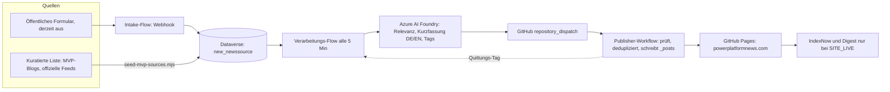

# Spezifikation: Power Platform News

Stand: 30.09.2026, überarbeitet nach unabhängiger Gegenprüfung · Status: **Entwurf zur Freigabe, nichts ist live** · Branch `ccr-453447c5-qyg2zo` (nicht gemerged)
Bezug: Governance-Repo `powerplatformgovernance` @ `4f34575`. Verweise der Form `gov:datei:zeile` meinen dieses Repo. Die Dokumentation dort wurde am 30.09.2026 an den Code angepasst (Branch `ccr-453447c5-qyg2zo`, Commit `77912f0`, ebenfalls nicht gemerged). Die Befunde aus Anhang A stehen dort gekürzt unter „Bekannte Lücken“.
Das Go-Live selbst steht im [Runbook](2026-09-30_go-live-runbook.md).

## 1. Kurzfassung und Empfehlung

**Ist die Idee Unsinn? Nein.** Der Bestand ist im Kern eine themenneutrale Kuratierungs-Engine mit einer dünnen Governance-Schicht. Der Wechsel auf Power Platform News ist überwiegend Konfiguration: Die erzeugten Flow-Definitionen (Verarbeitung 1.217 Zeilen, Einreichung 291 Zeilen JSON) unterscheiden sich vom Governance-Original nur in Werten: Tabellen- und Schlüsselnamen, GitHub-Ziel, User-Agent und Prompt-Text (Scope, Frischeregel, Statusangaben und Zielgruppen). Die Aktionsstruktur ist identisch.

**Aber nicht als 1:1-Einschalten.** Fünf Bedingungen müssen erfüllt sein, bevor die Seite Inhalte öffentlich ausspielt:

1. **Scope-Schärfe.** „Copilot Studio, nicht Copilot“ ist nur so gut wie der Prompt. Er ist geschrieben, aber noch nicht an echten Beispielen geprüft (WP-04).
2. **Vertrauensmodell der Quellen.** Im Bestand wird jede öffentlich eingereichte URL, die wie ein Feed aussieht, ohne Relevanzprüfung freigegeben und dauerhaft abgefragt (F5), und eine Einreichung, die nicht geprüft werden kann, wird alle fünf Minuten neu abgerufen (F19). Für eine öffentlichere Seite ist das zu offen.
3. **Kapazität und Lizenz.** Ein sequenzieller Fünf-Minuten-Flow verbraucht schon mit 15 Quellen geschätzt rund 90.000 Aktionen pro Tag, ab ca. 50 Quellen rund 300.000 (Abschnitt 7). Nach Suchauszügen der Microsoft-Dokumentation liegen die Tageslimits je Lizenz bei 6.000, 40.000 oder 250.000 Anfragen. Schon der Pilot kann also das mittlere Limit überschreiten. Die Lizenz ist deshalb eine Bedingung vor dem Pilot (WP-20, Tor 2) und nicht nur ein Kostenpunkt.
4. **Rechts- und Transparenzpunkte** vor dem Launch: KI-Kennzeichnung, Leistungsschutzrecht, Microsoft-Marke, Impressum, Datenschutz (Abschnitt 6, E11).
5. **Drei Schwächen in der Aufhol- und Fehlerlogik** beheben, die bei einer aktiveren Seite eher zuschlagen: überzählige Feed-Einträge (F1), still verlorene Einzelartikel (F17) und die nie gekürzte ID-Liste (F2).

**Empfehlung:** **GO für einen Stufenplan** (Seite für Suchmaschinen gesperrt → Pilot mit 10–15 Quellen → stufenweiser Ausbau → Launch). **NO-GO** für „alle 284 vorbereiteten Quellen und öffentliche Einreichung am ersten Tag“.

**Zur Sichtbarkeit:** Vor dem Launch ist die Seite im Netz erreichbar, aber für Suchmaschinen gesperrt (`noindex`, `Disallow`). Das ist eine Bitte an Crawler und keine Zugangssperre: Wer die Adresse kennt, kann Seiten, `feed.xml`, `sitemap.xml` und `llms.txt` lesen. Wer das nicht will, schaltet Pages erst zum Launch ein (E12).

**Was bereits im Branch liegt:** ein Funktionsklon im Code, profilgesteuert und mit Sicherheitsschaltern (Launch-Schalter aus, alle Seiten `noindex`, `robots.txt` sperrt alles, keine Flows, IndexNow und Digest gesperrt, öffentliche Einreichung nicht freigegeben). Dazu ein Skript, das die Dataverse-Seite (Lösung, eigene Tabelle, Connection References, Ansichten, Formular) als Code anlegt. **Im Tenant wurde nichts angelegt oder verändert, und kein Skript lief gegen einen Tenant.** Die Seite enthält keine Beiträge und keine Quellendaten.

**Was von Marcel gebraucht wird:** 12 Entscheidungen (Abschnitt 8, davon 7 vor dem Pilot) und gemeinsame, interaktive Sitzungen für alles, was nur im Tenant geht (Bootstrap und Flow-Bereitstellung, GitHub-Zustimmung, Lizenzprüfung, DNS).

## 2. Was geklont wurde und was nicht

### 2.1 Vorgehen

- **Commit 1** (`d284fd2`) ist ein unveränderter Snapshot von Engine und Site-Skelett (71 Dateien im Baum, davon bestand `README.md` schon im ersten Commit). **Commit 2** enthält die Anpassungen für News, **Commit 3** die erste Fassung dieser Doku. Die folgenden Commits enthalten das Bootstrap-Skript, die korrigierten Seitentexte und die überarbeitete Doku nach den Gegenprüfungen. So zeigt `git diff d284fd2..HEAD` exakt, was sich geändert hat.
- Von den 71 Dateien des Snapshots blieben **32 unverändert**, 38 wurden angepasst, 1 verschoben (`robots.txt` nach `assets/robots.txt`). Dazu kommen 13 neue Dateien (u. a. Profil, drei Test-Dateien, Bootstrap-Skript, diese Doku). Der Baum hat damit 84 Dateien.
- Die generierten Flow-Definitionen wurden gegen das Governance-Original verglichen. Verarbeitung: 52 von 1.217 Zeilen weichen ab, alles Werte (Tabellen- und Schlüsselnamen, Repository, User-Agent, Prompt-Text). Einreichung: nur Tabellen- und Schlüsselnamen. Die Aktionsstruktur ist identisch.

### 2.2 Übernommen (Funktionsumfang)

Statische Chirpy-Seite mit DE/EN-Beiträgen und hreflang · Einreichungsformular und Webhook-Flow · Verarbeitungs-Flow (alle 5 Minuten, sequenziell, vier Quellarten: Artikel, RSS, YouTube, Podcast) · KI-Gate für Einreichungen · KI-Extraktion (Relevanz, Kurzfassung DE/EN, Tags, Kartentexte) · Publisher-Workflow mit Validierung, Deduplizierung und Quittungs-Tag · Karten-Bilder · Quellen-, Tag- und Archivseiten · SEO/GEO (JSON-LD, Canonical, hreflang, Sitemap, `llms.txt`) · IndexNow · Consent-Banner mit Google Analytics und Clarity · PWA · Brevo-Digest · MVP-Quellenlisten und Seed-Skript · Deploy-Skripte · Tests und CI. Neu gegenüber dem Bestand: Bootstrap-Skript für die Dataverse-Seite und die Anzeige des Quelldatums (F16).

### 2.3 Bewusst nicht übernommen

| Was | Warum |
|---|---|
| 76 Beitragspaare und 33 Kartenbilder | Identische Texte auf zwei Domains sind ein SEO-Risiko, und die Inhalte sind Governance-spezifisch (E2) |
| Seite „Admin Flows“ (10 Flows) | Governance-Inhalt, verweist auf Governance-Beiträge |
| `CNAME`, IndexNow-Schlüssel, GA- und Clarity-IDs der Governance-Seite | Identität der anderen Domain. Für News neu erzeugt bzw. leer |
| `README_CUSTOM.md` und vier Architektur-Dokumente | Sie beschreiben Governance und waren teils veraltet (F3). Dort am 30.09. nachgeführt, für News durch diese Spezifikation ersetzt |
| `digest-sent.json` | Zustand des anderen Digests. News startet leer |

### 2.4 Tenant-Seite

Es gab weder `az`- noch `pac`-Zugriff, und die Sandbox blockiert Dataverse, die Power-Apps- und Flow-APIs und beliebige externe Hosts. Was **im Code** lag und damit geklont ist: Tabellen-Definition, beide Flow-Definitionen, Deploy-Skripte. Was im Bestand **nicht im Repo** lag (F7) und jetzt als Code vorbereitet ist: Lösung, eigene Tabelle, fünf Connection References, vier Ansichten und das Hauptformular (`tools/bootstrap-solution.mjs`). Das Skript

- schreibt nur mit `--apply` und ergänzt nur, es löscht nichts und überschreibt kein von Hand geändertes Formular (ausser mit `--replace-form`),
- liest zuerst alles, was vom Tenant abhängt (Herausgeber, vorhandene Tabelle samt Auswahlwerten, Bindungsquelle), und bricht vor dem ersten Schreiben ab, wenn etwas nicht passt,
- wurde ausschliesslich gegen einen simulierten Dataverse getestet (18 Tests, darunter der Aufruf ohne Azure-Anmeldung).

Nicht als Code vorhanden und im Tenant wiederzuverwenden: der Custom Connector `AzureAIFoundry-Privat` und die Foundry-Bereitstellungen `model-router` und `whisper`. Die Laufhistorie des Bestands lässt sich nicht klonen. Siehe WP-01 und WP-18.

## 3. Zielbild und Scope

### 3.1 Positionierung

Power Platform News sammelt, was in **Power Apps, Power Automate und Copilot Studio** neu ist, als kurze, quellenbasierte Zusammenfassung mit Hinweis „Was das bedeutet“ und direktem Link zum Original. Die Schwesterseite Power Platform Governance bleibt für Steuerung, Sicherheit und Betrieb zuständig. Verlinkt ist bisher nur in eine Richtung: News nennt Governance (About, Startseite, `llms.txt`), Governance nennt News noch nicht (WP-19).

**Nicht-Ziele:** keine Volltexte, keine vollständigen Übersetzungen, keine fremden Bilder, keine Kommentare, keine Inhalte hinter Login oder Paywall.

### 3.2 Scope

| Bereich | Status | Hinweis |
|---|---|---|
| Power Apps (Canvas, Model-driven, Code Apps, Maker-Erlebnis) | **im Scope** | Produkt-Tag `power-apps` |
| Power Automate (Cloud- und Desktop-Flows, Agent-Flows, Connectors) | **im Scope** | Produkt-Tag `power-automate` |
| Copilot Studio (Agenten bauen, erweitern, verwalten, Lizenz/Credits) | **im Scope** | Produkt-Tag `copilot-studio` |
| Dataverse, Power Pages | begleitend | Nur im Zusammenhang mit den drei Produkten. Tags `dataverse`, `power-pages` |
| Plattformweite Änderungen (Admin, Lizenz, ALM, Sicherheit, Roadmap) | begleitend | Soweit sie die drei Produkte direkt betreffen |
| Microsoft 365 Copilot, GitHub Copilot, Security Copilot, Dynamics-365-Copilot, Consumer-Copilot | **ausserhalb** | Nur im Scope, wenn es um das **Bauen von Agenten mit Copilot Studio** geht |
| Power BI, Microsoft Fabric | **Schalter, aus** | In `_data/profile.json` unter `tags.optional`. Aus, weil die Quellenbasis fehlt: von 109 MVP-Blogs deckt keiner Power BI ab und einer Fabric |
| Allgemeine KI-Nachrichten, Werbung, Stellenanzeigen, Event-Anmeldeseiten | ausserhalb | |

### 3.3 Was als „News“ zählt

Etwas Neues oder Geändertes: Ankündigung, Preview, allgemeine Verfügbarkeit, Einstellung (Deprecation), Preis- oder Lizenzänderung, Roadmap, Sicherheitshinweis, bemerkenswerter Community-Beitrag zu einer neuen Fähigkeit. Weiche Frischeregel im Prompt: älter als 12 Monate oder lange vergangene Ereignisse als „bevorstehend“ → nicht veröffentlichen. Die Regel ist nur ein Prompt-Hinweis, keine harte Prüfung (WP-04 entscheidet, ob eine harte Prüfung im Flow nötig ist).

### 3.4 Taxonomie (Tags)

- **Produkte:** `power-apps`, `power-automate`, `copilot-studio`, `dataverse`, `power-pages`
- **Themen:** `ai-agents`, `announcement`, `how-to`, `licensing`, `deprecation`, `security`, `governance`, `alm`, `community`
- **Phase 2 (aus):** `power-bi`, `fabric`

Die Liste steht nur im Profil. Prompt und Publisher lesen beide daraus und können nicht auseinanderlaufen (Test: *the extraction prompt offers exactly the active tags*).

### 3.5 Inhaltsregeln

Übernommen aus den Governance-Kurationsregeln: Quelle, Autor und Originaltitel vor der Zusammenfassung; Hauptlink direkt zum Original; Kurzfassung statt Ersatz (Ziel 35–65 Wörter, im Bestand Ø 52, Spanne 42–78 auf Englisch); Einreicher-Namen nur mit ausdrücklicher Zustimmung; Offenlegung gemeinsamer Herausgeberschaft (PowerPlatformTip).
Neu für News:

- **Quelldatum:** Der Publisher speichert Erst- und Änderungsdatum der Quelle seit jeher, gezeigt wurden sie nie (F16). Im Klon steht unter der Quellenangabe „Original published …, updated …“ bzw. „Originalbeitrag vom …, aktualisiert am …“, und zwar nur, wenn das Datum bekannt ist. Ein unverändertes Datum wird nicht als Aktualisierung dargestellt.
- **Je Beitrag:** Status-Angabe (GA, Preview, Rolling out, Retiring) auf der Karte, Überschrift „What it means / Was das bedeutet“ und ein **sichtbarer KI-Hinweis** (E5).
- **Auf About und in `llms.txt`:** der Hinweis „unabhängig, nicht mit Microsoft verbunden“. Er steht nicht auf jedem Beitrag.

## 4. Architektur

### 4.1 Ende-zu-Ende

### 4.2 Entscheidung: eigene Lösung statt gemeinsamer Flow

Empfohlen und von Marcel am 30.09.2026 bestätigt („wäre auch sinnvoll für die Trennung“): eigene Lösung `PowerPlatformNews` in **derselben Umgebung** wie Governance, mit eigener Tabelle `new_newssource`, eigenen Connection References (`new_news_*`) und zwei eigenen Flows. Wiederverwendet werden Umgebung, Custom Connector `AzureAIFoundry-Privat` und die Foundry-Bereitstellungen `model-router` und `whisper`.

| Kriterium | Eigene Lösung (empfohlen) | Gemeinsame Tabelle und Flow |
|---|---|---|
| Isolation bei Fehlern und Missbrauch | hoch: ein Flow kann ausgeschaltet werden, ohne die andere Seite zu berühren | niedrig: Fehler trifft beide Seiten |
| Durchsatz | zwei unabhängige Warteschlangen | eine Warteschlange, halbiert den Durchsatz je Seite |
| Doppelte Abfragen derselben Feeds | ja (Nachteil) | nein |
| Aufwand der Umstellung | gering, weil Generator, Bootstrap und Deploy parametrisiert sind | hoch: Mandantenspalte, zwei Quittungen je Quelle, Dispatch je Seite |

Die gemeinsame Variante lohnt sich erst, wenn Doppelabfragen zum Problem werden (Abschnitt 7). Dann ist die Zusammenlegung ein eigenes Projekt.

### 4.3 Das Profil als einzige Quelle der Wahrheit

`_data/profile.json` enthält Namen, Domain, Kontaktadresse, Scope-Texte, Tags, Dataverse- und Flow-Namen, Flow-Kennungen, Farben, Karten- und Digest-Texte. Es wird gelesen von:

| Verbraucher | Nutzt |
|---|---|
| `tools/automation.mjs`, `intake.mjs`, `seed-mvp-sources.mjs`, `bootstrap-solution.mjs` (Node) | Konfiguration, Prompts, Tabellendefinition, Namen von Lösung, Ansichten und Connection References |
| `tools/publish-curation.rb` (Ruby) | Tag-Liste, Autor-ID, Überschriften, Karten-Alt-Text, Offenlegung |
| `tools/render_card.py`, `send_digest.py` (Python) | Kicker, Hashtag, Domain, Digest-Einstellungen |
| Jekyll-Templates (`site.data.profile`) | Palette, Sameas-Liste, KI-Hinweis, Kontaktadresse in About und Datenschutz |
| PowerShell-Skripte | über die von Node ausgegebene Konfiguration |

Zwei Werte sind nicht ganz „eine Quelle“: Der erlaubte Publisher-Akteur (`github.authorisedPublisher`) steht zusätzlich fest im Workflow, und ein Test prüft, dass beide übereinstimmen. Die Beschreibung (`description`) in `_config.yml` ist von Hand geschrieben.

### 4.4 Launch-Schalter und Tore

| Mechanismus | Wirkung | Standard jetzt |
|---|---|---|
| `launch` in `_config.yml` | `false`: `noindex` auf jeder Seite, `robots.txt` sperrt alles, keine Sitemap-Angabe | `false` |
| Repository-Variable `SITE_LIVE` | Gibt IndexNow und Digest frei | nicht gesetzt |
| `direct_webhook` in `_data/submission.yml` | `false`: Der Build **bricht ab** („Invalid submission endpoint“), sobald ein Secret mit einer signierten Webhook-URL gesetzt ist. Ohne Secret bleibt das Formular deaktiviert | `false` |
| Secret `SUBMISSION_ENDPOINT` | Ohne Secret ist das Formular deaktiviert | nicht gesetzt |
| `digest.enabled` im Profil | `false`: Digest sendet nichts | `false` |
| Flows | werden ausgeschaltet bereitgestellt | nicht bereitgestellt |
| Seed-Skript | Trockenlauf ist Standard, `--apply` schreibt. Quellen entstehen freigegeben, aber **deaktiviert** | |
| Bootstrap-Skript | Trockenlauf ist Standard, `--apply` schreibt, nur Ergänzungen | |

`check-site.rb` erzwingt, dass gerenderte Seiten und `robots.txt` zum Schalter passen. Ein gestarteter Build besteht die Prüfung für „nicht gestartet“ nicht, und umgekehrt. Diese Negativkontrolle wurde von Hand geprüft, sie läuft nicht automatisch.

### 4.5 Datenmodell und Zustände

Tabelle `new_newssource` mit denselben Feldern wie im Bestand: Name, URL, Quelltyp (Artikel, RSS, YouTube, Podcast), Freigabe, Verarbeitung aktiviert, Verarbeitungsstatus, Einreicher-Felder mit Einwilligung, Zeitstempel, Wasserzeichen, gesehene Feed-IDs, Fehlerzähler, letzter Status. Die Zahlenwerte der Auswahlfelder sind im Code fest (z. B. Artikel `100000000`, RSS `100000001`). Das Bootstrap-Skript prüft sie bei einer vorhandenen Tabelle und bricht bei Abweichung ab.
Ablauf: `Needs review → Ready → Awaiting GitHub result → Published` (Artikel) bzw. zurück auf `Ready` (RSS); ein einzelner Artikel, der nicht veröffentlicht wird, geht auf `Needs review`; Fehler → `Error`, nach drei Fehlern `Needs review`; ohne GitHub-Quittung nach 24 Stunden → `Needs review`.

### 4.6 Sicherheitsmerkmale (übernommen)

Nur HTTPS, Port 443, keine Zugangsdaten in URLs, keine IP-Ziele (geprüft wird die Schreibweise des Hosts, Redirects und DNS-Auflösung nicht, F21) · fremde Inhalte sind „untrusted data“ in den Prompts · Modellausgabe wird im Publisher erneut streng validiert (Länge, Tag-Liste, URL, Datum, Escaping von HTML und Liquid) · URL wird vom Flow gesetzt, nicht vom Modell · Publisher akzeptiert nur den konfigurierten GitHub-Akteur · Honeypot-Feld und Einwilligung nur bei `yes` · Erfolgsquittung als Git-Tag `curation-results/<id>`.

## 5. Funktionsmatrix

| Funktion | Governance (Bestand) | News-Klon | Anmerkung |
|---|---|---|---|
| Statische Seite, PWA, DE/EN-Beiträge mit hreflang | ja | übernommen | Farben aus Profil. Keine DE-Startseite (E9) |
| Einreichungsformular | ja | übernommen, **deaktiviert** | `direct_webhook: false` (E4). Texte versprechen keine Prüfung durch einen Menschen mehr und laden nur zu Artikeln ein |
| Intake-Webhook-Flow | ja | übernommen, nicht bereitgestellt | Name aus Profil |
| Verarbeitungs-Flow, vier Quellarten | ja | übernommen, **logikgleich** | Deploy legt den Flow bei Erstinstallation an |
| KI-Gate für Einreichungen | ja, autonom | übernommen, Scope News plus Frische | Vertrauensmodell E3 |
| KI-Extraktion | ja | übernommen, Prompt für News | Copilot-Studio-Abgrenzung |
| Publisher-Workflow | ja | übernommen | Tags, Autor, Überschrift aus Profil |
| Karten-Bilder | ja | übernommen | Kicker, Hashtag, Domain aus Profil, neutraler Status-Punkt statt Häkchen |
| Quellen-, Tag-, Archivseite | ja | übernommen | |
| Quelldatum unter der Quellenangabe | nein (F16) | **neu** | nur wenn bekannt |
| SEO/GEO, Sitemap, `llms.txt` | ja | übernommen, domain-neutral | Bild-URLs im JSON-LD jetzt absolut |
| `robots.txt` | ja | **neu**: per Launch-Schalter | Behebt F9 |
| IndexNow | ja | übernommen, hinter `SITE_LIVE` | Domain und Schlüssel aus Profil |
| Consent-Banner, GA, Clarity | ja | übernommen, **nur mit IDs** | Banner nennt aktive Dienste, DE/EN (behebt F4) |
| Datenschutzseite | nur GA | **neu geschrieben**, bedingt | nennt auch Google Fonts und jsDelivr. Rechtsprüfung E11, besser selbst hosten (WP-09) |
| Digest (Brevo) | ja | übernommen, **aus** | E8 |
| Seed-Skript und MVP-Listen | ja, aktiv | übernommen, **Trockenlauf als Standard**, deaktiviert, `--limit`, `--feed-from`, Scope-Filter, YouTube nur per Option | doppelte Kanäle werden entfernt |
| Bootstrap der Dataverse-Seite | nein (F7) | **neu**, nur Trockenlauf und simulierte Tests | `tools/bootstrap-solution.mjs` |
| Deploy-Skripte | ja | übernommen, parametrisiert | nur geparst, nicht gegen einen Tenant ausgeführt |
| Tests und CI | ja | übernommen, plus 45 neue Tests | 62 Node-Tests, Publisher- und Seitenprüfungen |
| Admin-Flows-Seite, Altbeiträge | ja | **nicht übernommen** | siehe 2.3 |
| Profil, Launch-Schalter, KI-Hinweis je Beitrag | nein | **neu** | |

## 6. Ehrliche Bewertung: Risiken und Bedingungen

| # | Risiko | Warum es zählt | Gegenmassnahme |
|---|---|---|---|
| R1 | Scope-Drift: allgemeine Copilot-Nachrichten rutschen durch | „Copilot“ ist der häufigste Begriff im Umfeld und leicht zu verwechseln | Expliziter Ausschluss in beiden Prompts, Test auf Präsenz. **WP-04**: Stichprobe mit echten Grenzfällen |
| R2 | Öffentliche Feeds und nicht prüfbare Einreichungen | Kapazität, Backlink-Missbrauch, Angriffsfläche für Prompt-Injection, Dauerabfrage alle fünf Minuten (F19) | Öffentliche Einreichung aus (E4). **WP-06**: Feeds nur nach manueller Freigabe, Haltezustand für nicht prüfbare Einreichungen |
| R3 | Kapazität und Lizenz des Polling-Flows | Abschnitt 7. Das Tageslimit könnte schon im Pilot überschritten werden | **WP-20** (Lizenz), **WP-05** (Messung), **WP-21** (Stellhebel), Fallback-Architektur (E10) |
| R4 | SEO: „Scaled Content“ und fehlender Mehrwert | Automatisch erzeugte Zusammenfassungen fremder Inhalte in Masse sind ein bekanntes Qualitätsrisiko bei Suchmaschinen | Mehrwert durch „What it means“, Produkt-Tags und Statusangabe. Keine Kopie der Governance-Texte. Soft-Launch hinter `noindex`. Qualitätsstichproben im Pilot |
| R5 | Urheber- und Leistungsschutzrecht | Bei einer *News*-Seite nah an Presse-Inhalten. Was in Deutschland als „sehr kurzer Auszug“ gilt, ist nicht abschliessend geklärt. Die Zusammenfassungen haben im Schnitt 52 Wörter | Eigene Worte, keine Zitate, keine Bilder. **WP-08** Blocklist und Takedown. **E11** rechtliche Prüfung |
| R6 | Transparenz bei KI-Texten | Die EU-KI-Verordnung kennt Kennzeichnungspflichten für KI-erzeugte Texte, die die Öffentlichkeit informieren sollen. Nach öffentlichen Auszügen gilt Artikel 50 seit dem 2. August 2026 (nicht bestätigt, mögliche Verschiebungen nicht geprüft). Ob und mit welchen Ausnahmen (etwa bei redaktioneller Kontrolle) das für diese Seite gilt, ist zu prüfen | Sichtbarer KI-Hinweis je Beitrag und auf der About-Seite (im Klon umgesetzt). **E11** |
| R7 | Marke „Power Platform“ und Nähe zu Microsoft | Domain und Name verwenden Microsoft-Marken | Unabhängigkeits-Hinweis auf About und in `llms.txt` (im Klon umgesetzt). **E11**: Microsoft-Markenrichtlinien prüfen |
| R8 | Datenschutz und Anbieterkennzeichnung | Kein Impressum, Datenschutz nur Englisch, Verarbeiter (Microsoft, GitHub, ggf. Brevo) teils nicht genannt. Jede Seite lädt Google Fonts und jsDelivr vor jeder Zustimmung | Im Klon nennt der Text die geladenen Dienste. **WP-09**: Impressum, deutscher Text, besser selbst hosten |
| R9 | Missbrauch des öffentlichen Formulars | Kein Rate-Limit, kein CAPTCHA (bewusst akzeptiert im Bestand) | Formular aus. **WP-13** Schutz vor Freigabe |
| R10 | Zwei Forks driften auseinander | Fehlerkorrekturen müssen doppelt gemacht werden | Konvergenz-Vertrag (Anhang B), **WP-17** |
| R11 | YouTube und Podcast unbelegt | Kein Beitrag stammt daraus (152 Dateien, 64 mit `source_type`, alle `article`), undokumentierter Endpunkt, fehlerhafte Kanalzuordnung, schwache URL-Erkennung, Podcast nur von Hand (F6) | Nur per Option, erst nach eigener Prüfung |
| R12 | Breite GitHub-Berechtigung | Die Power-Platform-Verbindung arbeitet mit weitreichenden OAuth-Rechten am Konto (F12) | Feingranulare Alternative prüfen, eigene Verbindung nur für diesen Zweck (das Deploy-Skript braucht dann `-GitHubConnection`) |
| R13 | Betrieb hängt an wenigen Konten | Niemand bemerkt Ausfälle | **WP-12**: Alarme für Flow, Publisher und Budget |
| R14 | Einträge gehen still verloren | Überzählige Feed-Einträge (F1) und fehlgeschlagene Einzelartikel (F17) gelten als gesehen und kommen nie wieder. Bei einer aktiven Seite merkt das niemand | **WP-07**. Bis dahin: Backfill nur für Feeds mit höchstens 30 Einträgen im Zeitraum, Pilot täglich beobachten |
| R15 | Sichtbarkeit vor dem Launch | Die Seite ist erreichbar und lesbar, auch mit `noindex`. Nach einem Launch entfernt `launch: false` bereits indexierte Seiten nicht zuverlässig, weil die `robots.txt`-Sperre Crawler daran hindert, das `noindex` zu lesen (siehe Runbook, Notbremse) | **E12** |

## 7. Kapazität und Kosten

### 7.1 Bekannte Grössen

- **Quellenbasis:** 109 MVP-Blogs (106 verschiedene Feed-Hosts), davon **107** mit Bezug zu Power Apps, Power Automate oder Copilot Studio (die zwei anderen sind Power-Pages-Blogs). 175 YouTube-Kanäle (171 verschiedene, vier Kanäle sind je zwei Personen zugeordnet), standardmässig nicht gesät. Offizielle Microsoft-Feeds sind **nicht** in den Listen (WP-03). Im Governance-Projekt wurden die Blog-Feeds einmal abgerufen (Commit `c74fc43`: 109 von 165 Kandidaten antworteten mit Feed-Inhalt). Für News wurde nichts geprüft.
- **Bestandsleistung Governance:** 61 kuratierte Beitragspaare in 8 Kalendertagen aus 14 Quellen-Sites. Nach UTC-Datum waren es 6, 23, 1, 21, 6, 1, 2 und 1 Paare (23. bis 30.09.); 44 davon fallen auf zwei Tage, vermutlich Backfill-Läufe. Zuletzt 1–2 pro Tag. Wie viele Quellen im Governance-Flow aktuell aktiv sind, ist aus dem Repo nicht ablesbar.
- **Aktionen pro ruhender RSS-Quelle:** 21 (aus der Flow-Definition gezählt, alle vorhanden) plus 3 pro Lauf.

### 7.2 Modell (Annahme: 6 s je ruhender Quelle)

Die 6 Sekunden sind eine **Annahme**, die Grössenordnung (Faktor 2–3) zählt, nicht die Zahl.

| Aktive Quellen | Aktionen je Lauf | Laufdauer | Läufe/Tag | Aktionen/Tag (≈) |
|---|---|---|---|---|
| 15 | 318 | 1,5 min | 288 | 92.000 |
| 50 | 1.053 | 5 min | 288 | 303.000 |
| 107 | 2.250 | 10,7 min | 134 | 302.000 |
| 278 (inkl. YouTube) | 5.841 | 27,8 min | 51 | 298.000 |

Lesart: Ab etwa 50 Quellen ist der Flow **dauerbeschäftigt**, und der Tagesverbrauch hängt nur noch von der Dauer einer Aktion ab (≈ 86.400 s ÷ Sekunden je Aktion). Die „5 Minuten“ sind dann nur noch Wunschtakt, tatsächlich wird jede Quelle erst nach einer Laufdauer wieder abgefragt.

**Lizenzgrenzen.** Nach Suchauszügen der Microsoft-Dokumentation „Requests limits and allocations“ (die Seite selbst war nicht abrufbar, die Zahlen sind unbestätigt) gelten je nach Lizenz Tageslimits von 6.000, 40.000 oder 250.000 Anfragen, und jede Aktion zählt als Anfrage. Nach diesem Modell überschreitet der Flow bei 288 Läufen am Tag die mittlere Stufe (40.000) **ab 7 aktiven Quellen** (288 × (21 × 7 + 3) = 43.200), schon der Pilot mit 15 Quellen liegt mit 92.000 deutlich darüber. Der bestehende Governance-Flow zählt möglicherweise zu derselben Zuteilung. Überschreitung führt in der Regel zur Drosselung, nicht zum Abschalten, was die Laufzeit weiter verlängert. Das ist der Grund für WP-20 als Bedingung vor dem Pilot.

### 7.3 Stellhebel

1. **Poll-Intervall je Quelle:** nur Quellen abfragen, deren `new_lastchecked` älter als z. B. 30 Minuten ist (Filter in `List_sources`). Reduziert die Last grob um den Faktor 6 bei 30 Minuten. Umsetzung: WP-21.
2. **Staffelung:** selten postende MVP-Blogs seltener, Microsoft-Kanäle häufiger (WP-21).
3. **Klein anfangen:** Pilot mit 10–15 Quellen.
4. **Fallback:** Polling in einen GitHub-Actions-Job verlegen (Node-Skript, versioniert), Power Automate nur noch für Einreichung und Dispatch. Die Minuten eines privaten Repositories sind kontingentiert, ein Fünf-Minuten-Takt sind rund 8.640 Läufe im Monat. Auslöser: Laufdauer > 15 Minuten im Regelbetrieb oder dauerhafte Drosselung (WP-21).

### 7.4 Kosten, die zu klären sind

- **Lizenz:** Der Verarbeitungs-Flow nutzt HTTP-Aktionen und den Custom Connector, der Einreichungs-Flow den Request-Trigger und Dataverse. Deckt die vorhandene Lizenz zwei weitere Cloud-Flows ab, welches Tageslimit gilt, und wie viel verbraucht der Governance-Flow schon? (WP-20)
- **KI:** Pro neuem Kandidaten ein Foundry-Aufruf mit bis zu 30.000 Zeichen Seitentext, pro Einreichung zusätzlich das Gate. Den Preis der `model-router`-Bereitstellung kenne ich nicht. Im Pilot messen, Budget-Alarm setzen (WP-12).

## 8. Offene Entscheidungen

„Wann“: **P** = vor dem Pilot, **L** = vor dem Launch, **S** = später.

| # | Entscheidung | Empfehlung | Wann |
|---|---|---|---|
| E1 | Scope: Power Pages als Begleit-Tag, Power BI und Fabric aus? | Ja und ja. Power BI/Fabric erst mit eigener Quellenbasis (WP-15) | P |
| E2 | Governance-Altbestand kopieren? | **Nein.** Start leer, optional Backfill über die Pipeline mit Startzeitpunkt (`--feed-from`), solange F1 offen ist nur für Feeds mit höchstens 30 Einträgen im Zeitraum | P |
| E3 | Vertrauensmodell: A = kuratierte Liste (vorfreigegeben), B = öffentliche Einzelartikel (KI-Gate), C = öffentliche Feeds | C nur mit **manueller Freigabe** (WP-06). B darf beim KI-Gate bleiben | P |
| E4 | Öffentliche Einreichung: wann? | Erst nach WP-06 und WP-13 (Rate-Limit oder CAPTCHA). Bis dahin aus | P |
| E5 | Sichtbare KI-Kennzeichnung je Beitrag | **Ja** (im Klon umgesetzt, Text im Profil änderbar) | P |
| E6 | Marke und Kanäle: Farben, Logo, Favicon, LinkedIn-Seite? | Platzhalter-Palette und -Social-Bild sind drin. Final durch Marcel | L |
| E7 | Analytics: eigene GA4-Property und Clarity-Projekt? | Ja, **nicht** die Governance-IDs mitnutzen | L |
| E8 | Digest zum Launch? | Nein. Erst mit Anmeldeformular, Double-Opt-in, Absender und Datenschutztext | S |
| E9 | Sprachen: DE/EN wie Governance, DE-Startseite und DE-Listen? | DE/EN ja. DE-Listen in Phase 2 (WP-16) | S |
| E10 | Kapazitätsgrenze und Fallback | Vor dem Pilot die Schwelle festlegen (Laufdauer 15 Minuten, siehe 7.3). Über den Fallback wird bei Tor 4 anhand der Messung (WP-05) entschieden | P |
| E11 | Rechtliche Prüfung vor Launch | Ja, extern: Leistungsschutzrecht, Microsoft-Marke, Impressum, KI-Kennzeichnung, Datenschutz inkl. Auftragsverarbeitung | L |
| E12 | Sichtbarkeit vor dem Launch: Pages schon für den Pilot einschalten (erreichbar, aber für Suchmaschinen gesperrt) oder erst zum Launch? | Schon für den Pilot einschalten, um Domain, HTTPS und Builds zu prüfen. Dann sind die Pilotbeiträge aber für jeden lesbar, der die Adresse kennt. Wer das nicht will, schaltet Pages erst zum Launch ein und prüft bis dahin lokal (`bash tools/run.sh`) | P |

## 9. Arbeitspakete

Aufwand ist eine grobe Schätzung. „M“ = Marcel erforderlich (Tenant, Konten, Entscheidungen).

| WP | Inhalt | Aufwand | Akzeptanzkriterium | Tor |
|---|---|---|---|---|
| 00 | Klon, Profil, Launch-Schalter, Bootstrap-Skript, Tests, Doku (**erledigt** in diesem Branch; Tenant-Teile nie gegen einen Tenant gelaufen) | – | 62 Node-Tests, Publisher-Tests, Build in beiden Launch-Zuständen, `check-site`, `htmlproofer` grün | – |
| 01 | **Dataverse-Bereitstellung (M):** `node tools/bootstrap-solution.mjs` (Trockenlauf lesen, dann `--apply`), Verbindungen kontrollieren, danach `deploy-intake.ps1` und `deploy-automation.ps1` (beide Flows bleiben aus) | 2–4 h | Ein zweiter Bootstrap-Lauf meldet alles als vorhanden, beide Deploy-Skripte melden `DefinitionVerified = True`, beide Flows existieren und sind aus | 2 |
| 02 | **Seite und Domain (M):** Pages-Quelle „GitHub Actions“, Custom Domain, DNS, HTTPS, Domain-Verifizierung, Merge Branch → `main` | 1–2 h plus DNS-Wartezeit | Build grün, Seite erreichbar, `robots.txt` = `Disallow: /`, `noindex` auf jeder Seite | 1 |
| 03 | **Quellen:** offizielle Microsoft-Feeds recherchieren und **einzeln verifizieren**, in `tools/extra-sources.json`. Pilot-Set 10–15 festlegen | 2–4 h | Jede URL liefert HTTP 200 und gültiges XML, und die Beitragslinks der Einträge haben denselben Host wie die Feed-Adresse (Host-Regel, F18). Bei abweichendem Host entscheiden, ob die Regel erweitert werden muss | 3 |
| 04 | **Prompt-Evaluation im Pilot:** Rückdatierter Auswertungslauf (`--feed-from`, nur Feeds mit höchstens 30 Einträgen im Zeitraum, F1) und Regelbetrieb. Bewertet werden **alle vom Modell entschiedenen Kandidaten**, mindestens 40 (Treffer, Fehltreffer, Copilot-Grenzfälle, Preview-als-GA). Verworfene Kandidaten werden im Flow nicht gespeichert, ihr Grund steht nur in der Laufhistorie | 1–2 Tage | Präzision ≥ 90 %, **0** Treffer zu M365-Copilot oder GitHub Copilot in der Stichprobe, keine Preview als GA dargestellt | 4 |
| 05 | **Kapazitätsmessung** im Pilot: Laufdauer und Aktionen aus der Laufhistorie, Hochrechnung | 1 h/Woche | Zahl je Lauf und je Tag dokumentiert, E10 entschieden | 4 |
| 06 | **Vertrauensmodell härten:** `Is_feed` darf öffentliche Feeds nicht mehr automatisch freigeben (Freigabe bleibt offen). Eine Einreichung, die nicht geprüft werden kann, braucht einen Haltezustand oder einen geänderten Filter in `List_sources`, sonst wird sie alle fünf Minuten neu abgerufen (F19). `rel="nofollow"` für nicht kuratierte Quellen prüfen | 1 Tag | Testfälle: eingereichter Feed bleibt `Awaiting approval` und wird nicht erneut abgerufen. Eine Einreichung mit dauerhaftem Fehler wird nach dem dritten Fehler nicht mehr im Lauf aufgegriffen | 4 |
| 07 | **Aufhol- und Fehlerlogik (F1, F2, F17, F20):** Nur verarbeitete IDs als gesehen bestätigen. Dafür braucht es eine dauerhafte Untergrenze (Startzeitpunkt oder Wasserzeichen), sonst fluten ab dem zweiten Lauf alle älteren Einträge herein. Fehlgeschlagene Artikel nicht als gesehen markieren, ID-Liste begrenzen, Charge je Übergabe senken. Der festgeschriebene Test (`automation.test.mjs`, „capped and caught up gradually“) wird angepasst. In beiden Seiten | 1 Tag | Test: Feed mit 45 ungesehenen Einträgen verarbeitet alle in drei Läufen. Einträge vor dem Startzeitpunkt bleiben ausgeschlossen. Ein fehlgeschlagener Artikel wird im nächsten Lauf erneut versucht. Gesehene IDs bleiben begrenzt | 4 |
| 08 | **Blocklist und Takedown:** Publisher und Intake prüfen gegen eine Sperrliste (URL oder Host) | 2–4 h | Gesperrte URL wird nicht veröffentlicht, auch nicht nach erneuter Einreichung | 5 |
| 09 | **Recht und Datenschutz:** Impressum, deutsche Datenschutzerklärung, Verarbeiter, Ergebnis von E11 einarbeiten. Schriftarten und Symbole (Google Fonts, jsDelivr) selbst hosten, damit nichts vor der Zustimmung von Dritten geladen wird. Chirpy bietet dafür `assets.self_host` in `_config.yml`; nötig wären das Submodul `assets/lib` (steht in `.gitmodules`, ist aber nicht eingebunden) und `submodules: true` im Checkout-Schritt des Workflows. Nicht ausprobiert (M, extern) | extern | Freigabe durch Marcel. Die Seite lädt vor der Zustimmung nichts von Dritten, oder der Text nennt es | 5 |
| 10 | **Marken-Assets:** Logo, Favicon, finales Social-Bild, Palette (M) | extern | Ersetzt die Platzhalter | 5 |
| 11 | **Analytics:** IDs eintragen, Banner-Test in DE und EN | 1 h | Banner nennt nur aktive Dienste, nichts lädt vor Zustimmung | 5 |
| 12 | **Überwachung:** Alarm bei Flow-Fehlern, Publisher-Fehlern (GitHub-Benachrichtigung) und Foundry-Budget, Uptime-Check | 2–4 h | Testalarm kommt an | 5 |
| 13 | **Schutz der Einreichung (optional):** Proxy mit Rate-Limit und Bot-Schutz vor dem Webhook, dabei Redirect- und DNS-Kontrolle beim Abruf bedenken (F21) | 1–2 Tage | Missbrauchstest gedrosselt | nach E4 |
| 14 | **Digest (optional):** Anmeldung, Double-Opt-in, Liste, Absender | 0,5–1 Tag | siehe E8 | S |
| 15 | **Power BI und Fabric:** Quellenbasis, Prompt, Tags, Schalter im Profil | 2–3 Tage | Stichprobe wie WP-04 | S |
| 16 | **DE-Startseite, DE-Archiv, DE-Tags**; Seitenleiste „Recently Updated“ und Block „Further Reading“ nach Sprache filtern (F15) | 1–2 Tage | DE-Nutzer erreichen Inhalte ohne Umweg über EN, keine gemischten Sprachen in Seitenleisten und Leseempfehlungen | S |
| 17 | **Gemeinsame Engine:** Profil-Anpassungen nach Governance zurückportieren (auch die Meldungstexte in `assets/js/submission.js`, die Quelldatum-Anzeige und die umbenannten Plugin-Module), Fixes in einer Quelle pflegen | 1–2 Tage | Beide Repos haben identischen Engine-Code | S |
| 18 | **Lösung ins Repo exportieren** (`pac solution export` und `unpack`) als Wiederherstellungs- und Klonbasis (M) | 1–2 h | Entpackte Lösung im Repo | S |
| 19 | **Governance-Website berichtigen (M):** About, Einreichung und Bestätigungsmeldung, Datenschutz und Banner (F3, F4) sowie Verlinkung zur Schwesterseite. Die Doku dort ist bereits nachgeführt | 2–4 h | Texte entsprechen dem Betrieb | S |
| 20 | **Lizenz und Anfragenkontingent klären (M):** Welche Lizenz deckt beide Flows, welches Tageslimit gilt, wie viel verbraucht der Governance-Flow schon? | 1–2 h | Dokumentierte Zahl, die 15 Pilotquellen plus Governance abdeckt, oder die Entscheidung für den Fallback (E10) | 2 |
| 21 | **Stellhebel umsetzen:** Poll-Intervall je Quelle, Staffelung, bei Bedarf Fallback-Polling in GitHub Actions (7.3) | 1–2 Tage | Laufdauer ≤ 15 Minuten bei der Zielzahl von Quellen, oder der Fallback läuft | 4, falls die Messung (WP-05) es verlangt |

## 10. Go-Live-Stufen und Kriterien

Der Ablauf mit Befehlen steht im [Runbook](2026-09-30_go-live-runbook.md). Kurzform:

| Tor | Zustand | Bedingung zum Erreichen |
|---|---|---|
| 0 | Entscheidungen | E1–E5, E10 und E12 bestätigt |
| 1 | Seite steht, für Suchmaschinen gesperrt | WP-02 erledigt, `noindex` und `Disallow` per `curl` belegt |
| 2 | Flows bereit, aus | WP-01 und WP-20 erledigt, `DefinitionVerified = True`, Lizenz geklärt |
| 3 | Pilot (10–15 Quellen, zuerst rückdatierter Auswertungslauf, dann 7–14 Tage Regelbetrieb, noch `noindex`) | WP-03 erledigt. Tägliche Sichtkontrolle |
| 4 | Ausbau (+25 Quellen pro Woche) | WP-04, WP-05, WP-06, WP-07 erledigt, WP-21 falls nötig. Laufdauer im Rahmen |
| 5 | Launch | WP-08 bis WP-12 erledigt, E11 abgeschlossen. `launch: true` und `SITE_LIVE=true` gleichzeitig |

**Messbare Kriterien für Tor 3 → 4:** Präzision ≥ 90 % in einer Stichprobe von mindestens 40 vom Modell entschiedenen Kandidaten (aus Auswertungslauf und Pilot) · 0 falsche Copilot-Zuordnungen · keine Preview als GA · mittlere Laufdauer ≤ 4 Minuten bei ≤ 15 Quellen · keine ungeklärten Flow-Fehler · Foundry-Kosten je veröffentlichtem Beitrag dokumentiert und im Budget.
Zur Grösse der Stichprobe: Unter der Annahme von 1–4 Beiträgen je Blog und Monat liefern 15 Quellen in 7–14 Tagen nur etwa 4–28 Kandidaten vor dem Relevanzfilter. Deshalb gibt es den rückdatierten Auswertungslauf: 15 Quellen mit Startzeitpunkt 60 Tage zurück ergeben unter derselben Annahme etwa 30–120 Kandidaten.
**Notbremse:** Flow ausschalten, `launch: false` setzen und `SITE_LIVE` entfernen, fehlerhafte Beiträge per Commit löschen. Nach einem Launch entfernt `launch: false` indexierte Seiten nicht zuverlässig, siehe Runbook.

## 11. Nicht geprüft und Annahmen

- **Kein Tenant-Zugriff.** Nicht gesehen: aktive Flows, Laufhistorie, Anzahl aktiver Quellen im Governance-Flow, Formular, Ansichten, Custom-Connector-Definition, Lizenzstatus, Secrets und Variablen der Repositories, Foundry-Kosten und -Kontingent.
- **Keine externen Hosts aus der Sandbox.** Deshalb keine Messung des echten Feed-Volumens, keine Verifikation von Feed-URLs und keine Abfrage von Microsoft- und GitHub-Dokumentation. Die Aussagen zu Lizenzstufen, Zählregeln für Anfragen, DNS-Werten und zur KI-Verordnung stammen aus Suchauszügen und sind unbestätigt.
- **PowerShell nie gegen einen Tenant ausgeführt.** Die drei Skripte bestehen den PowerShell-Parser (PowerShell 7.4.6), und die Vergleichslogik von `deploy-intake.ps1` wurde mit Beispieldaten geprüft. Der Anlege-Zweig für den Verarbeitungs-Flow und die neue Sperre in `test-intake-live.ps1` sind ungetestet.
- **Bootstrap nur simuliert.** Ob der Tenant die erzeugten Ansichten und das Formular so annimmt (Steuerelement-Klassen, Layout-XML), ist offen. Fehler dabei sind nicht fatal, die Objekte lassen sich dann im Maker-Portal von Hand anlegen.
- **Plattformverhalten nicht geprüft:** Reihenfolge und Grenzen des RSS-Connectors, ob ein abgefangener Artikelfehler zusätzlich den äusseren Zweig der Quelle auslöst (F17), ob Scope, Switch und Bedingung als Anfragen zählen, ob der Test im Designer für einen per API angelegten, ausgeschalteten Flow funktioniert.
- **Host der Beitragslinks** der 8 Feeds mit abweichendem Host (F18) ist offline nicht prüfbar.
- **Prompts nicht gegen Foundry getestet.** Ihre Qualität ist bis WP-04 eine Annahme.
- **Kartenvorschau mit Ersatzschrift.** Die produktive Pipeline lädt Kalam. Zeilenumbrüche können dort abweichen.
- **Lokale Toolchain:** Ruby 3.3.6 und Node 22, die CI nutzt Ruby 3.4.
- **Workflow-YAML:** nur auf Syntax geprüft.
- **Keine Rechtsberatung.** Alle rechtlichen Hinweise sind Prüfaufträge, keine Bewertungen.
- **Annahme zum Volumen:** MVP-Blogs posten typischerweise selten, etwa 1–4 Beiträge je Blog und Monat. Das ergäbe aus 107 Blogs grob 4–14 neue Einträge pro Tag vor dem Relevanzfilter. Belegt ist das nicht. Wie viele der Feeds mehr als 30 Einträge führen, ist offen.

---

## Anhang A: Befunde im Bestand (Governance @ `4f34575`)

Schwere: **H** hoch, **M** mittel, **N** niedrig. „Klon“ zeigt, was hier geschehen ist. Alle Befunde stammen aus der Lektüre von Code und Repository. Einen am Live-System belegten Fall gibt es nicht.

| # | Schw. | Befund | Beleg | Klon |
|---|---|---|---|---|
| F1 | M | **Überzählige Feed-Einträge gehen verloren.** `Set_feed_IDs` markiert *alle* aktuellen IDs des Feeds als gesehen, der Deckel verarbeitet aber nur die ersten 30 in Feed-Reihenfolge (angenommen: die neuesten). Der Kommentar behauptet „catches up gradually“, und ein Test schreibt das Verhalten fest. Tatsächlich werden Einträge jenseits der 30 nie mehr angefasst (Beispiel: 45 ungesehene Einträge, 30 verarbeitet, 45 gespeichert, beim nächsten Lauf 0 ungesehen). Das gilt auch, wenn keiner der Einträge veröffentlicht wird. Betroffen: Erstläufe mit weit zurückliegendem Startzeitpunkt (Backfill, E2), mehrtägige Ausfälle und sehr aktive Feeds. Nicht betroffen sind Quellen, die das Seed-Skript ohne Startzeitpunkt anlegt, denn sie beginnen bei ihrer Erstellungszeit. Der Auslöser der Änderung war ein Podcast-Feed mit mehr ungesehenen Folgen als dem Deckel beim Erstlauf (Commit `764d54c`). Ob seither Einträge verloren gingen, ist nicht nachgezählt | `gov:tools/automation.mjs:152`, `:154`, `:158-168`, `:233`, `:240`, `:285`; Test `gov:tools/automation.test.mjs:308-311` | unverändert (Logik-Treue), **WP-07** |
| F2 | N | **Liste gesehener IDs wird nie gekürzt, die Doku versprach eine Grenze.** Die Betriebsdoku vom 18.09. nannte 2.000 gemerkte IDs und `Needs review` bei Überschreitung. Der Commit `764d54c` hat beides bewusst entfernt, die Doku war veraltet (in der Governance-Doku am 30.09. korrigiert). Ein echtes Risiko besteht nur bei Feeds mit instabilen IDs: bis zu 30 Bewertungen je Abruf, und das Memo-Feld (höchstens 1.000.000 Zeichen) wäre nach grober Rechnung in ein bis zwei Tagen voll | `gov:2026-09-18_architektur_automation_betrieb.md:83`; `gov:tools/automation.mjs:68-69`, `:154` | unverändert, **WP-07** |
| F3 | H | **Aussagen weichen vom Code ab.** Die Doku beschrieb manuelle Freigabe. Seit dem 24.09. (`f087b68`, der Code folgt im Korrekturcommit `b87a60b`) entscheidet ein KI-Gate endgültig ohne Mensch. Die About-Seite sagt „Community suggestions are reviewed before publication“, die Einreichungsseite „after review“ und „Send for review“, die Bestätigungsmeldung „submitted for review“ | `gov:tools/automation.mjs` (`submissionGatePrompt`, `Pending_approval`); `gov:_tabs/about.md:24,42`; `gov:_tabs/submit.md:10,36`; `gov:assets/js/submission.js:45,64` | Texte und Meldungen neu und wahrheitsgemäss (die Meldungen weichen damit vom Engine-Stand ab, WP-17). Governance-Doku nachgeführt, Governance-Website **WP-19** |
| F4 | H | **Consent und Datenschutz unvollständig.** Clarity lädt nach Zustimmung, Banner und Datenschutzseite nennen nur Google Analytics. Das Banner sagt „By continuing … you consent“, obwohl technisch Opt-in gilt. Die Datenschutzseite behauptet, Name und LinkedIn würden ohne Haken „used only to credit/contact you privately“, der Code speichert sie ohne Haken gar nicht. Verarbeiter (Microsoft, GitHub) fehlen. Jede Seite lädt Google Fonts und jsDelivr, bevor der Besucher etwas entschieden hat, und der Text nennt beide nicht | `gov:_includes/cookie-consent.html:99-100`; `gov:_tabs/privacy.md:22,34,47-48`; `gov:_config.yml` (Clarity); `gov:_includes/head.html:103-122` | Banner und Text bedingt und korrekt, Google Fonts und jsDelivr genannt (`check-site.rb` prüft das). Selbst hosten: **WP-09**. Governance-Website **WP-19** |
| F5 | H | **Öffentliche Feeds werden ohne Relevanzprüfung freigegeben und dauerhaft abgefragt.** Jede eingereichte URL, die wie ein Feed aussieht, wird `Approved` und aktiviert; nur die URL-Prüfung (HTTPS, öffentlicher Host, keine Zugangsdaten) läuft vorher. Die Erkennung ist weit gefasst: Content-Type mit `xml`, `rss` oder `atom`, `<rss` oder `<feed` in den ersten 500 Zeichen oder ein Text, der mit `<?xml` beginnt (das trifft auch Sitemaps, SVG und XHTML). Der Einreicher bestimmt Header und Anfang. Bewertet werden erst später die einzelnen Einträge | `gov:tools/automation.mjs:253`, `:258-259` | Einreichung aus, **WP-06** |
| F6 | M | **YouTube und Podcast unbelegt und für öffentliche Einreichungen kaum erreichbar.** Implementiert und getestet, aber kein Beitrag stammt daraus (152 Dateien, nur 64 tragen `source_type`, alle `article`, der Rest wird nach URL beurteilt). Transkripte kommen über den undokumentierten Endpunkt `youtube.com/api/timedtext`, nur auf Englisch. Die Erkennung prüft nur die Textteile `v=`, `youtu.be/` und `/shorts/` ohne den Host, sodass auch `?rev=3` in den YouTube-Zweig geht. Der Podcast-Zweig braucht die von Hand gesetzte Quellart `Podcast`, die kein Flow setzt. Vier Kanäle sind je zwei Personen zugeordnet | `gov:tools/automation.mjs:177`, `:182`, `:185`; Zählung der `source_type`-Felder; `gov:tools/mvp-youtube-channels.json` | YouTube nur per Option, Duplikate entfernt |
| F7 | M | **Dataverse-Bootstrap nicht aus dem Repo reproduzierbar.** Im Repo: Tabellen- und Flow-Definitionen. Nicht im Repo: Lösung, Formular, Ansichten, Connection References, Custom Connector. Das Deploy-Skript setzte eine bestehende Flow-ID voraus | `gov:tools/deploy-automation.ps1:13,50` | `tools/bootstrap-solution.mjs` (nie gegen einen Tenant gelaufen), das Skript legt den Flow an, **WP-01**, **WP-18** |
| F8 | M | **Fest verdrahtete Kennungen** (Tenant, Umgebung, Flow-IDs, Domain, GA- und Clarity-IDs, Brevo-Liste, IndexNow-Schlüssel, Namen) in 23 Engine- und Seitendateien (dazu Doku und `CNAME`) | Suche über das Repo | Profil |
| F9 | N | **`robots.txt` wird doppelt erzeugt** (eigene Datei und Theme-Datei). Das Ergebnis hing von der Schreibreihenfolge ab, jeder Build warnt | Build-Ausgabe „destination shared by multiple files“ | Datei am Theme-Pfad, deterministisch |
| F10 | M | **Kein Impressum**, Datenschutz nur Englisch | `gov:_tabs/` | **WP-09**, E11 |
| F11 | N | **Digest ohne Anmeldung im Repo.** Versand vorhanden, Anmeldeformular und Double-Opt-in nicht | Suche nach Formular-Bezeichnern | Digest aus, E8 |
| F12 | M | **Breite GitHub-Berechtigung.** Der Publisher schützt sich nur durch die Akteur-Prüfung. Die Verbindung selbst hat weitreichende Rechte am Konto. Das Deploy-Skript verlangt genau eine verbundene GitHub-Verbindung oder `-GitHubConnection` | `gov:.github/workflows/publish-curation.yml:16`; `gov:2026-09-18_architektur_automation_betrieb.md:88`; `gov:tools/deploy-automation.ps1:28-35` | offen, R12 |
| F13 | M | **Kein Takedown-Mechanismus.** Die Doku verlangt, Wiederaufnahme nach Entfernung zu verhindern. Der Publisher dedupliziert nur gegen vorhandene Beiträge | `gov:2026-09-18_architektur_kuration_und_quellen.md:17`; `gov:tools/publish-curation.rb` | **WP-08** |
| F14 | N | Relative Bild-URLs im BlogPosting-JSON-LD | `gov:_includes/metadata-hook.html` | absolut |
| F15 | N | **Die Seitenleiste „Recently Updated“ und der Block „Further Reading“ mischen DE- und EN-Titel**, sie sind nicht nach Sprache gefiltert. Bei der Bildschirmprüfung des Klons aufgefallen und im Governance-Build bestätigt. Die Quelle ist ein Chirpy-Baustein der Engine | Bildschirmprüfung von Startseite und Beitrag im Klon, Build des Bestands | unverändert, **WP-16** |
| F16 | N | **Das Originaldatum wird nie angezeigt.** Der Publisher speichert `source_published_at` und `source_updated_at` im Front Matter, kein Template zeigt sie. Die About-Seite sagt das Gegenteil („distinguish the source's publication date from our entry date“) | `gov:tools/publish-curation.rb` (Front Matter); `gov:_includes/curated-attribution.html`; `gov:_tabs/about.md:24` | Im Klon umgesetzt (nur wenn bekannt), geprüft in `check-site.rb` und im Publisher-Test. Governance **WP-17** |
| F17 | M | **Einzelne Artikel gehen still verloren.** Schlägt bei einem Eintrag Abruf, Bewertung oder Host-Prüfung fehl (Zeitüberschreitung, Drosselung bei Foundry, Lesefehler, Host-Abweichung), fängt `Catch_article` den Fehler und überspringt den Eintrag. Seine ID steht aber schon in `SeenIDs` und wird mit der Charge bestätigt, er wird nie wieder versucht. Nicht geprüft: ob der abgefangene Fehler zusätzlich den äusseren Zweig der Quelle auslöst (bei der abgefangenen 404 der Quittung war das so) | `gov:tools/automation.mjs:154`, `:223-225`, `:233`, `:240`, `:285` | unverändert, **WP-07** |
| F18 | N | **Host-Regel für Feed-Einträge.** Ein Eintrag, dessen Link einen anderen Host hat als die Feed-Adresse, wird verworfen und als gesehen markiert. Ein Feed ohne passende Einträge liefert dauerhaft nichts und meldet keinen Fehler. Bei 8 der 107 Blogs weicht der Feed-Host vom Host der Startseite ab (z. B. `feeds.transistor.fm`, `rss.blog.naver.com`, oder nur durch `www.`) | `gov:tools/automation.mjs:179`, `:220` | unverändert, Prüfung in **WP-03** |
| F19 | M | **Eine Einreichung, die nicht geprüft werden kann, bleibt offen und wird alle fünf Minuten neu abgerufen.** `List_sources` liest jeden Datensatz mit `Awaiting approval`, unabhängig vom Verarbeitungsstatus. Nach einem Fehler gibt es `Error`, nach dem dritten `Needs review`, die Freigabe bleibt aber offen, und die Adresse wird weiter abgerufen (je Abruf mit zwei Wiederholungen). Der Fehlerzähler ist auf 1.000 begrenzt und wäre nach gut drei Tagen voll, die Wirkung ist nicht geprüft | `gov:tools/automation.mjs:70`, `:298`, `:303`, `:314` | unverändert, **WP-06** |
| F20 | N | **Übergabe an GitHub: 30 Artikel könnten die Payload-Grenze überschreiten (nicht geprüft).** Nach unserer Kenntnis begrenzt GitHub das `client_payload` auf 65.535 Zeichen (Dokumentation nicht abrufbar). Ein Artikelobjekt ist im Bestand rund 3 bis 4 Tausend Zeichen gross (geschätzt aus den 61 Paaren, Mittel rund 3,4 Tausend, Maximum rund 3,9 Tausend): ab etwa 16 bis 19 Artikeln würde die Übergabe abgelehnt. Der Fehler wäre sichtbar, würde aber dreimal dieselbe Charge neu bewerten lassen und dann `Needs review` setzen | `gov:tools/automation.mjs:167`, `:234-237` | unverändert, **WP-07** |
| F21 | N | **Redirects und DNS-Auflösung werden beim Abruf nicht kontrolliert.** Die Erstplanung verlangte, private Netzwerkziele beim Abruf zu blockieren. Umgesetzt ist nur die Prüfung der Host-Schreibweise, und seit der autonomen Freigabe ruft der Flow jede eingereichte URL ab | `gov:2026-09-18_architektur_kuration_und_quellen.md:35`; `gov:tools/automation.mjs` (`hostSafetyCheck`) | unverändert, Einreichung aus (E4), **WP-13** |

## Anhang B: Konvergenz-Vertrag

Ziel: Der Engine-Code soll zwischen beiden Seiten identisch sein, damit Fehlerkorrekturen einmal gemacht und per Diff übernommen werden können. **Das ist heute nicht der Fall**: Der Klon ist profilgesteuert, der Bestand nicht. Erst WP-17 portiert die profilgesteuerte Engine nach Governance zurück.

| Seitenspezifisch (darf abweichen) | Engine (soll nach WP-17 identisch sein) |
|---|---|
| `_data/profile.json`, `_config.yml` | `tools/*` ausser den seitenspezifischen Dateien links und `profile.test.mjs` |
| `_data/authors.yml`, `contact.yml`, `submission.yml`, `locales/` (Tab-Titel hängen von den vorhandenen Seiten ab) | `_plugins/`, `_layouts/`, `_includes/` ausser `home-intro.html` |
| `_includes/home-intro.html`, `_tabs/about.md`, `_tabs/privacy.md`, `_tabs/submit.md` | `_data/share.yml` |
| `llms.txt`, `<IndexNow-Schlüssel>.txt`, `assets/img/*` | `.github/workflows/*` (ohne Seitenwerte) |
| `README.md`, `docs/`, `tools/digest-sent.json`, `tools/extra-sources.json`, `tools/profile.test.mjs` (enthält die Kennungen der anderen Seite als Negativliste) | `assets/css/*`, `assets/js/*`, `assets/robots.txt`, `sitemap.xml` |

Zwei Abweichungen sind bekannt und gehören in WP-17: In `_plugins/` heissen zwei Module im Klon anders (`CuratedSources` statt `GovernanceSources`, `SubmissionEndpoint` statt `GovernanceSubmission`, Umgebungsvariable `SUBMISSION_ENDPOINT` statt `GOVERNANCE_SUBMISSION_ENDPOINT`), und `assets/js/submission.js` hat zwei geänderte Meldungstexte (F3).

Drei Dinge hängen am Vertrag und sind getestet: Der Test *no identifiers of another site are left* scannt Engine und Seite auf Fremdkennungen. Die Profil-Tests prüfen Tags, Scope, Benennung und Workflow-Bezug. Die Flow-Definitionen unterscheiden sich nur in Werten (2.1).

## Anhang C: Was verifiziert wurde

| Prüfung | Ergebnis |
|---|---|
| Baseline im Governance-Bestand (Kopie): Node-Tests (17), Publisher-Tests, Build, `check-site` (158 Seiten), `htmlproofer` (355 Links) | grün |
| Node-Tests im Klon | 62 von 62 (17 Bestand, 45 neu) |
| Publisher-Tests im Klon, inkl. Profil-Vertrag und Quelldatum | grün |
| Vergleich erzeugter Flow-Definitionen mit Governance | nur Werte weichen ab (52 von 1.217 Zeilen bzw. Tabellen- und Schlüsselnamen), Aktionsstruktur gleich |
| Durchlauf mit dem echten Publisher: 3 erfundene Beispielartikel, je DE/EN, Karten (mit Ersatzschrift), Build, `check-site` (13 Seiten), `htmlproofer`. Die Beispielartikel lagen nur in einer Wegwerfkopie, nicht im Repo | grün, `launch: false` und `launch: true` |
| Negativkontrollen (von Hand): gestarteter Build besteht die „nicht gestartet“-Prüfung nicht. Datenschutzseite ohne Google Fonts bzw. jsDelivr fällt durch | schlagen wie vorgesehen fehl |
| Cookie-Banner und Datenschutztext mit gesetzten und ohne Analytics-IDs | verhalten sich wie beschrieben |
| Bootstrap-Skript gegen einen simulierten Dataverse: Trockenlauf schreibt nichts, Wiederholung ändert nichts, Fehler vor dem ersten Schreiben, keine Löschoperation, fremdes Formular bleibt unberührt, Aufruf ohne Azure-Anmeldung endet mit einer Meldung statt einem Stacktrace | 18 Tests grün. Nie gegen einen Tenant |
| PowerShell: Parser auf alle drei Skripte, Vergleichslogik von `deploy-intake.ps1` mit Beispieldaten | fehlerfrei, nicht gegen einen Tenant ausgeführt |
| Workflow-YAML | syntaktisch gültig |
| Unabhängige Gegenprüfung dieser Spezifikation und der Governance-Doku durch je einen zweiten Prüfer, der Code und Repos las und Scratch-Kopien baute | Befunde sind eingearbeitet |
